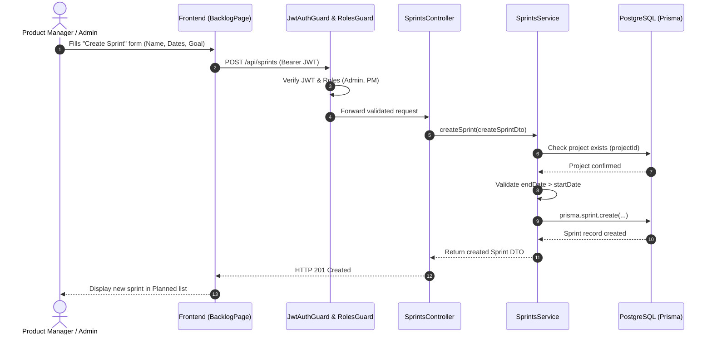
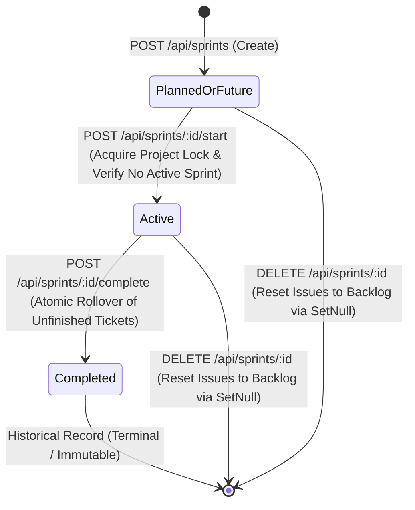
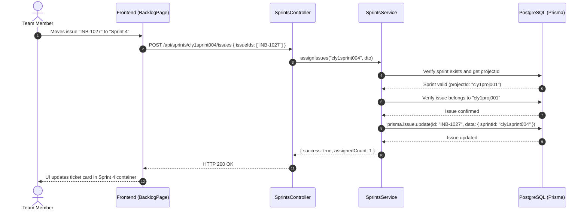
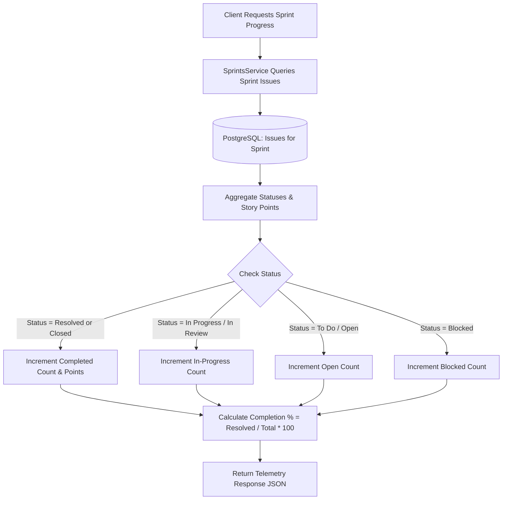
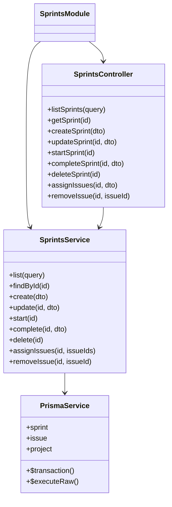

# Sprints Module Specification

## Ticketing Management Platform (Inbox / GoldMine Portal)

---

## 1. Document Overview

### 1.1 Purpose
This document establishes the comprehensive, implementation-ready architectural and functional specification for the **Sprints Module (`SprintsModule`)** within the **Ticketing Management Platform (Inbox / GoldMine Portal)**.

The Sprints Module governs Agile sprint iterations, sprint ceremonies (creation, configuration, starting, completion, and rollover), backlog-to-sprint capacity planning, iteration progress telemetry, concurrency protection for active iterations, and sprint-issue lifecycle bindings.

### 1.2 Scope
- **Backend Architecture**: REST API contracts, NestJS controller and service designs, DTO validation schemas, Prisma relational queries, pessimistic locking for single-active-sprint invariant enforcement, and atomic rollover transactions.
- **Domain Modeling**: `Sprint` database entity, `SprintStatus` lifecycle states, and relational bindings with `Project`, `Issue`, `ActivityEvent`, and `Notification`.
- **Frontend Integration**: End-to-end integration specifications for [`BacklogPage.tsx`](file:///c:/Users/kirit/ticketing_tool/frontend/src/pages/BacklogPage.tsx), [`KanbanBoard.tsx`](file:///c:/Users/kirit/ticketing_tool/frontend/src/pages/KanbanBoard.tsx), [`IssueDetailPage.tsx`](file:///c:/Users/kirit/ticketing_tool/frontend/src/pages/IssueDetailPage.tsx), [`CreateIssueModal.tsx`](file:///c:/Users/kirit/ticketing_tool/frontend/src/components/issue/CreateIssueModal.tsx), and [`AppContext.tsx`](file:///c:/Users/kirit/ticketing_tool/frontend/src/context/AppContext.tsx).
- **Security & Governance**: Strict Role-Based Access Control (RBAC), multi-tenant project isolation, race condition mitigation, and audit logging.

### 1.3 Intended Audience
- **Backend Engineers**: Implementing NestJS controllers, services, guards, and Prisma transactions.
- **Frontend Engineers**: Connecting React components, context providers, and API client methods.
- **QA Engineers**: Authoring unit, integration, concurrency, and end-to-end test suites.
- **System Architects & Tech Leads**: Reviewing API consistency, security boundaries, and domain isolation.

### 1.4 Related Architecture Documents
This specification adheres to and extends the existing documentation hierarchy:
1. [`BACKEND_ARCHITECTURE.md`](file:///c:/Users/kirit/ticketing_tool/BACKEND_ARCHITECTURE.md): Foundational domain analysis, directory structure (lines 707–715), and sprint route specifications (lines 1092–1124).
2. [`docs/01_SYSTEM_ARCHITECTURE.md`](file:///c:/Users/kirit/ticketing_tool/docs/01_SYSTEM_ARCHITECTURE.md): Macro architecture, system topology, security layers, and data pipelines.
3. [`docs/02_CODING_STANDARDS.md`](file:///c:/Users/kirit/ticketing_tool/docs/02_CODING_STANDARDS.md): Engineering standards, DTO validation patterns, exception formatting, and transaction guidelines.
4. [`docs/03_MODULE_IMPLEMENTATION.md`](file:///c:/Users/kirit/ticketing_tool/docs/03_MODULE_IMPLEMENTATION.md): Module 8 (`SprintsModule`) baseline specification (lines 900–1018).
5. [`docs/modules/PROJECT_MODULE.md`](file:///c:/Users/kirit/ticketing_tool/docs/modules/PROJECT_MODULE.md): Project tenancy, lead roles, and parent repository lifecycles.
6. [`docs/modules/ATTACHMENT_MODULE.md`](file:///c:/Users/kirit/ticketing_tool/docs/modules/ATTACHMENT_MODULE.md): Storage patterns, RBAC enforcement, and activity logging conventions.
7. [`docs/modules/AUTH_MODULE.md`](file:///c:/Users/kirit/ticketing_tool/docs/modules/AUTH_MODULE.md) and [`docs/modules/USER_MODULE.md`](file:///c:/Users/kirit/ticketing_tool/docs/modules/USER_MODULE.md): JWT tokens, user identities, and role assignments.

### 1.5 Dependencies on Existing Modules
- **`PrismaModule`** (Existing Verified): Database access, models, transactions (`$transaction`), and relational queries.
- **`AuthModule` & `common/guards`** (Existing Verified): JWT authentication via `JwtAuthGuard`, role enforcement via `RolesGuard` and `@Roles()`.
- **`ProjectsModule`** (Existing Verified): Validating parent project existence and ownership boundaries (`projectId`).
- **`IssuesModule`** (Planned): Associating issues to sprints via `Issue.sprintId` and handling rollover queries.
- **`ActivityModule`** (Existing Verified Schema): Emitting audit trail events (`sprint_created`, `sprint_started`, `sprint_completed`, `sprint_deleted`) via `ActivityEvent`.
- **`NotificationsModule`** (Existing Verified Schema): Emitting in-app notification records for assigned team members.

### 1.6 Documentation Status and Source Separation
- **Verified Repository Facts**:
  - `model Sprint` and `enum SprintStatus` are physically defined in [`backend/prisma/schema.prisma`](file:///c:/Users/kirit/ticketing_tool/backend/prisma/schema.prisma#L156-L172) and migrated in PostgreSQL (`backend/prisma/migrations/20261012111255_init/migration.sql:L68-L80`).
  - `Issue.sprintId` foreign key with `onDelete: SetNull` is physically defined in PostgreSQL (`migration.sql:L320`).
  - `enum NotificationType` already contains `sprint` in `schema.prisma:L95`.
  - Neither `ActivityEvent` nor `Notification` has a `sprintId` column in PostgreSQL.
  - Frontend components [`BacklogPage.tsx`](file:///c:/Users/kirit/ticketing_tool/frontend/src/pages/BacklogPage.tsx) and [`KanbanBoard.tsx`](file:///c:/Users/kirit/ticketing_tool/frontend/src/pages/KanbanBoard.tsx) already contain sprint UI layouts, currently backed by `localStorage` and `seedData.ts`.
- **Approved Requirements**:
  - Core sprint lifecycle operations (`GET /api/sprints`, `POST /api/sprints`, `PATCH /api/sprints/:id`, `POST /api/sprints/:id/start`, `POST /api/sprints/:id/complete`, `DELETE /api/sprints/:id`) approved in `BACKEND_ARCHITECTURE.md` Section 7 and `docs/03_MODULE_IMPLEMENTATION.md` Module 8.
- **Proposed Extensions (Pending Architecture Sign-off)**:
  - Dedicated sprint detail endpoint (`GET /api/sprints/:id`).
  - Sprint issue batch assignment endpoints (`POST /api/sprints/:id/issues`, `DELETE /api/sprints/:id/issues/:issueId`) as an alternative to `PATCH /api/issues/:id`.

### 1.7 Assumptions and Limitations
1. **Tenancy**: A sprint belongs to exactly one `Project` (`projectId`). Cross-project sprints are strictly prohibited.
2. **Issue Membership**: An issue belongs to at most one sprint at any given time (`Issue.sprintId` is nullable). Issues with `sprintId === null` reside in the project Backlog.
3. **Identifier Standards**:
   - `Issue.id` is a human-readable issue key string (e.g., `"INB-1027"`). It is the Primary Key. There is no separate `key` column on `model Issue`.
   - `Sprint.id` is a server-generated CUID (e.g., `"cly1sprint004proj1"`).
   - `Project.id` is a server-generated CUID (e.g., `"cly1proj001inbox"`), with a unique uppercase key (`Project.key`, e.g., `"INB"`).
4. **Execution State**: Backend source code for `SprintsModule` has not yet been authored in `backend/src/sprints/`. This document defines the exact contract to be implemented without modifying existing functional code.

---

## 2. Module Responsibilities

### 2.1 Functional Responsibility Classification

| Responsibility | Classification | Module Owner | Description |
|---|---|---|---|
| **Sprint Creation** | Approved Requirement | `SprintsModule` | Validates project, name, and dates; creates a `planned` sprint record. |
| **Sprint Listing & Filtering** | Approved Requirement | `SprintsModule` | Lists sprints filtered by `projectId` and optionally by `status`. |
| **Sprint Detail Retrieval** | Proposed | `SprintsModule` | Retrieves single sprint metadata, summary stats, and linked issues. |
| **Sprint Metadata Updates** | Approved Requirement | `SprintsModule` | Updates name, goal, and dates for uncompleted sprints. |
| **Sprint Activation (`start`)** | Approved Requirement | `SprintsModule` | Validates preconditions (single active sprint rule with pessimistic locking) and transitions sprint to `active`. |
| **Sprint Completion (`complete`)** | Approved Requirement | `SprintsModule` | Finalizes sprint (`completed`), records `completedDate`, and rolls over unfinished issues atomically. |
| **Sprint Deletion** | Approved Requirement | `SprintsModule` | Removes sprint record; database `onDelete: SetNull` resets linked issues (`sprintId = null`) to backlog. |
| **Issue Assignment to Sprint** | Proposed Endpoint / Approved Capability | `SprintsModule` / `IssuesModule` | Sets `Issue.sprintId` to assign a backlog or existing issue into a target sprint. |
| **Issue Removal from Sprint** | Proposed Endpoint / Approved Capability | `SprintsModule` / `IssuesModule` | Sets `Issue.sprintId = null` to return an issue to the backlog. |
| **Sprint Progress Telemetry** | Approved Requirement | `SprintsModule` | Dynamically computes total issues, story points, resolved counts, and completion rates. |
| **Story Point Estimation** | Out of Scope | `IssuesModule` | Individual ticket estimations (`storyPoints`) are owned by `Issue` records. |
| **Issue Status Transitions** | Out of Scope | `IssuesModule` | Moving tickets across Kanban workflow stages (`In Progress` -> `Resolved`) is owned by `IssuesModule`. |
| **Burndown Chart Generation** | Proposed | `ReportsModule` | Historical velocity and burndown snapshots are designated for reporting services. |

### 2.2 System Boundary Encapsulation
- **What `SprintsModule` Owns**: The `Sprint` entity lifecycle, sprint dates/goals, active state enforcement per project, atomic rollover of unfinished issues upon completion, and sprint-level aggregate progress calculations.
- **What `SprintsModule` Must NOT Own**: User authentication (delegated to `AuthModule`), ticket workflow progression (delegated to `IssuesModule`), project settings (delegated to `ProjectsModule`), or physical audit log storage (delegated to `PrismaService` / `ActivityModule`).

---

## 3. Existing Architecture and Dependency Analysis

### 3.1 Architectural Placement
The `SprintsModule` will reside in `backend/src/sprints/` (aligned with `backend/src/projects/` and `backend/src/users/`). It imports core infrastructure and domain modules while strictly avoiding circular dependencies:

```
                  ┌──────────────────────┐
                  │     PrismaModule     │ (Global DB Access)
                  └──────────┬───────────┘
                             │
            ┌────────────────┴────────────────┐
            ▼                                 ▼
   ┌─────────────────┐               ┌─────────────────┐
   │   AuthModule    │               │ ProjectsModule  │
   └────────┬────────┘               └────────┬────────┘
            │                                 │
            └────────────────┬────────────────┘
                             ▼
                  ┌──────────────────────┐
                  │    SprintsModule     │
                  └──────────┬───────────┘
                             │
            ┌────────────────┴────────────────┐
            ▼                                 ▼
   ┌─────────────────┐               ┌─────────────────┐
   │  IssuesModule   │               │ ActivityModule  │
   └─────────────────┘               └─────────────────┘
```

### 3.2 Dependency Table

| Dependency | Responsibility | Existing or Proposed | Integration Boundary |
|---|---|---|---|
| **`PrismaService`** | Database queries, entity relations, transactional execution (`$transaction`), and raw query locking (`$executeRaw`). | Existing Verified | Injected into `SprintsService`. |
| **`JwtAuthGuard`** | Extracts and validates Bearer JWT tokens in request headers. | Existing Verified (`common/guards/jwt-auth.guard.ts`) | Applied at controller level. |
| **`RolesGuard`** | Evaluates `@Roles()` metadata against authenticated user role. | Existing Verified (`common/guards/roles.guard.ts`) | Applied at controller and route level. |
| **`ProjectsModule`** | Validates `projectId` existence and project status. | Existing Verified (`src/projects/`) | Referenced via Prisma relational checks. |
| **`IssuesModule`** | Queries and mutates issue assignments (`sprintId`). | Planned | Cross-service calls or Prisma relational mutations. |
| **`ActivityService` / Prisma** | Records audit trail events in `ActivityEvent` table. | Existing Verified Schema | Persisted inside atomic transactions via `prisma.activityEvent.create()`. |

---

## 4. Sprint Domain Model

### 4.1 Prisma Schema Entity
The existing database schema in [`backend/prisma/schema.prisma`](file:///c:/Users/kirit/ticketing_tool/backend/prisma/schema.prisma#L156-L172) defines the `Sprint` model and `SprintStatus` enum:

```prisma
enum SprintStatus {
  active
  future
  completed
  planned
}

model Sprint {
  id            String       @id @default(cuid())
  projectId     String
  project       Project      @relation(fields: [projectId], references: [id], onDelete: Cascade)
  name          String
  startDate     DateTime
  endDate       DateTime
  status        SprintStatus @default(planned)
  goal          String?
  completedDate DateTime?
  createdAt     DateTime     @default(now())

  issues Issue[]

  @@index([projectId, status])
}
```

### 4.2 Field Specifications

| Field | Type | Required | Purpose | Source | Status |
|---|---|---|---|---|---|
| `id` | `String` (CUID) | Yes | Unique primary key for the sprint iteration. | Prisma `@default(cuid())` | Existing Verified |
| `projectId` | `String` (CUID) | Yes | Foreign key referencing parent `Project.id`. | Prisma `fields: [projectId]` | Existing Verified |
| `name` | `String` | Yes | Human-readable sprint title (e.g., "Sprint 4"). | Client input (`CreateSprintDto`) | Existing Verified |
| `startDate` | `DateTime` | Yes | Scheduled or actual iteration start timestamp. | Client input (`CreateSprintDto`) | Existing Verified |
| `endDate` | `DateTime` | Yes | Scheduled iteration target completion timestamp. | Client input (`CreateSprintDto`) | Existing Verified |
| `status` | `SprintStatus` | Yes | Lifecycle phase (`planned`, `future`, `active`, `completed`). | Prisma enum `@default(planned)` | Existing Verified |
| `goal` | `String?` | No | Sprint objective or deliverable summary. | Client input (`goal`) | Existing Verified |
| `completedDate` | `DateTime?` | No | Timestamp when sprint was completed and closed. | Server set on `/complete` | Existing Verified |
| `createdAt` | `DateTime` | Yes | Record creation audit timestamp. | Prisma `@default(now())` | Existing Verified |
| `issues` | `Issue[]` | No | Collection of issues assigned to this sprint (`sprintId`). | Prisma relation `Issue.sprintId` | Existing Verified |

> [!IMPORTANT]
> **Schema Field Observations**:
> 1. `model Sprint` in `schema.prisma` contains `createdAt DateTime @default(now())`, but does **NOT** contain an `updatedAt` / `updatedDate` column.
> 2. `model Issue` has `id: String @id` with format `"INB-1001"` (the issue key itself is the primary key; there is no separate `key` column).
> 3. `Issue.sprintId` is a nullable foreign key referencing `Sprint.id` with `onDelete: SetNull`.

### 4.3 Concept Distinctions

```
┌────────────────────────────────────────────────────────────────────────┐
│                          CONCEPT BOUNDARIES                            │
├─────────────────────────┬────────────────────────┬─────────────────────┤
│   Sprint Status         │   Issue Status         │   Project Status    │
│   (Iteration State)     │   (Workflow State)     │   (Tenancy State)   │
├─────────────────────────┼────────────────────────┼─────────────────────┤
│ • planned / future      │ • To Do / Open         │ • Active            │
│ • active                │ • In Progress          │ • Planning          │
│ • completed             │ • In Review            │ • Completed         │
│                         │ • Testing / QA         │ • On Hold           │
│                         │ • Blocked              │                     │
│                         │ • Resolved / Closed    │                     │
└─────────────────────────┴────────────────────────┴─────────────────────┘
```
- **Sprint Status** governs whether work is currently being executed in the iteration.
- **Issue Status** governs the individual ticket's lifecycle across the Kanban workflow.
- **Project Status** governs repository availability. A project that is `On Hold` or `Completed` cannot start new sprints.

---

## 5. Sprint Lifecycle & Concurrency Control

### 5.1 Lifecycle States and Transitions
The platform supports four enum states in `SprintStatus`: `planned`, `future`, `active`, and `completed`.
- In the frontend UI ([`BacklogPage.tsx`](file:///c:/Users/kirit/ticketing_tool/frontend/src/pages/BacklogPage.tsx)), newly created sprints are designated as `planned` or `future`. Both represent unstarted backlog iterations.
- An iteration can be started, moving to `active`.
- An active iteration can be finalized, moving to `completed`.

### 5.2 Transition Matrix

| Current State | Action | Next State | Preconditions | Failure Conditions |
|---|---|---|---|---|
| `planned` / `future` | `start` (`POST /api/sprints/:id/start`) | `active` | 1. Parent project row locked with `SELECT FOR UPDATE`.<br>2. No other sprint in the same project is currently `active`.<br>3. `startDate` and `endDate` are valid.<br>4. User has `Admin` or `Project Manager` role. | Returns `400 Bad Request` if another active sprint exists in the project. Returns `404 Not Found` if sprint does not exist. |
| `active` | `complete` (`POST /api/sprints/:id/complete`) | `completed` | 1. Sprint is currently in `active` status.<br>2. User has `Admin` or `Project Manager` role.<br>3. Optional `targetSprintId` must exist, be uncompleted, and belong to the same `projectId`. | Returns `400 Bad Request` if sprint is not currently `active`. Returns `404 Not Found` if target sprint is invalid. |
| `planned` / `future` | `update` (`PATCH /api/sprints/:id`) | `planned` / `future` | Sprint is not `completed`. Dates satisfy `endDate > startDate`. | Returns `400 Bad Request` if dates are invalid or sprint is `completed`. |
| `active` | `update` (`PATCH /api/sprints/:id`) | `active` | Allows updating `goal` and extending `endDate`. `startDate` modification is restricted. | Returns `400 Bad Request` if `endDate <= startDate`. |
| `completed` | Any Mutation | N/A (Terminal) | Completed sprints are immutable historical audit records. | Returns `400 Bad Request` ("Completed sprints cannot be modified or reopened"). |

### 5.3 Concurrency Control: Single-Active-Sprint Invariant

> [!CAUTION]
> **Race Condition Risk in Concurrent Starts**:
> PostgreSQL default transaction isolation is `Read Committed`. A standard check (`prisma.sprint.findFirst({ where: { projectId, status: 'active' } })`) does **NOT** place locks on non-existent or other candidate sprint records. If two administrators concurrently execute `POST /api/sprints/:idA/start` and `POST /api/sprints/:idB/start` for the same project, both queries can return `null`, allowing both transactions to commit `status = 'active'`, resulting in two active sprints.

#### Mandatory Mitigation: Parent Row Pessimistic Lock
Because `schema.prisma` does not currently define a partial unique constraint (`UNIQUE (projectId) WHERE status = 'active'`), `SprintsService.start()` **MUST** execute pessimistic row locking on the parent `Project` record inside `prisma.$transaction`:

```typescript
return await this.prisma.$transaction(async (tx) => {
  // 1. Lock the parent Project row exclusively to serialize sprint activation for this project
  const project = await tx.$executeRaw`
    SELECT id FROM "Project" WHERE id = ${sprint.projectId} FOR UPDATE
  `;

  // 2. Safely verify that zero other sprints are active
  const activeSprint = await tx.sprint.findFirst({
    where: { projectId: sprint.projectId, status: SprintStatus.active },
  });

  if (activeSprint && activeSprint.id !== id) {
    throw new BadRequestException(
      `Cannot start sprint. Project already has an active sprint: ${activeSprint.name}`,
    );
  }

  // 3. Update target sprint to active
  return tx.sprint.update({
    where: { id },
    data: { status: SprintStatus.active, startDate: new Date() },
  });
});
```
Any concurrent transaction attempting to start or complete a sprint on the same project is queued at step 1. When it acquires the lock, it re-queries step 2, detects the newly active sprint, and safely aborts with HTTP `400 Bad Request`.

---

## 6. Sprint and Issue Relationship

### 6.1 Relational Architecture
In `backend/prisma/schema.prisma`:
- `Sprint` has a one-to-many relation with `Issue`: `issues Issue[]`.
- `Issue` has an optional foreign key `sprintId String?` referencing `Sprint.id` with `onDelete: SetNull`.

```
┌─────────────────────────────────┐
│             Project             │
└───────────────┬─────────────────┘
                │ 1
                │
                ├────────────────────────────────┐
                │ *                              │ *
                ▼                                ▼
┌─────────────────────────────────┐    ┌─────────────────────────────────┐
│             Sprint              │    │              Issue              │
│  id (PK, CUID)                  │    │  id (PK, e.g. "INB-1001")       │
│  projectId (FK -> Project)      │    │  projectId (FK -> Project)      │
└───────────────┬─────────────────┘    │  sprintId (FK -> Sprint, Null)  │
                │ 1                    └─────────────────────────────────┘
                │                                ▲
                └────────────────────────────────┤
                  0..* issues assigned           │
```

### 6.2 Relationship Matrix

| Relationship | Current Implementation | Expected Behavior | Boundary Rules |
|---|---|---|---|
| **Sprint-to-Issues** | One-to-Many (`Sprint.issues`) | A sprint aggregates 0 to N issues. | Issues must belong to the exact same `projectId` as the sprint. |
| **Issue-to-Sprint** | Many-to-One Optional (`Issue.sprintId`) | An issue belongs to exactly 0 or 1 sprint. | When `sprintId === null`, the issue belongs to the Backlog. |
| **Issue Reassignment** | Update foreign key | Moving an issue between sprints changes `sprintId` directly. | Atomic operation; does not alter issue workflow status or comments. |
| **Sprint Deletion** | Database `SetNull` cascade | Deleting a sprint sets `sprintId = null` on all member issues. | **Sprint deletion never deletes tickets.** Tickets are safely returned to Backlog. |

> [!NOTE]
> **Database Index Notice**: In `backend/prisma/schema.prisma`, `Issue` does **NOT** currently have an `@@index([sprintId])`. Sprint-to-issue lookups rely on `where: { sprintId }`. A future performance migration should add `@@index([sprintId])` to `Issue`.

---

## 7. API Endpoint Specification

All endpoints are prefixed with the global API prefix `/api` and require valid JWT authentication.

### 7.1 Master Endpoints Catalog

| Method | Endpoint | Purpose | Authentication | Authorization | Status |
|---|---|---|---|---|---|
| `GET` | `/api/sprints` | List sprints filtered by project and status. | JWT Required | All Authenticated Roles | Approved Requirement |
| `POST` | `/api/sprints` | Create a new planned sprint. | JWT Required | `Admin`, `Project Manager` | Approved Requirement |
| `PATCH` | `/api/sprints/:id` | Update sprint name, goal, or dates. | JWT Required | `Admin`, `Project Manager` | Approved Requirement |
| `POST` | `/api/sprints/:id/start` | Activate a planned sprint (serialized). | JWT Required | `Admin`, `Project Manager` | Approved Requirement |
| `POST` | `/api/sprints/:id/complete` | Finalize active sprint and roll over unresolved tickets. | JWT Required | `Admin`, `Project Manager` | Approved Requirement |
| `DELETE` | `/api/sprints/:id` | Delete sprint and unassign attached issues to backlog. | JWT Required | `Admin`, `Project Manager` | Approved Requirement |
| `GET` | `/api/sprints/:id` | Retrieve single sprint details and issue breakdown. | JWT Required | All Authenticated Roles | Proposed |
| `POST` | `/api/sprints/:id/issues` | Bulk or single assign issues to a sprint. | JWT Required | `Admin`, `Project Manager`, `Developer`, `Engineer`, `Technical`, `QA` | Proposed |
| `DELETE` | `/api/sprints/:id/issues/:issueId` | Remove an issue from sprint back to backlog. | JWT Required | `Admin`, `Project Manager`, `Developer`, `Engineer`, `Technical`, `QA` | Proposed |

---

### 7.2 Detailed Endpoint Specifications

#### 1. `GET /api/sprints` (Approved Requirement)
- **Purpose**: Fetch a list of sprints, primarily filtered by project ID.
- **Query Parameters**:
  - `projectId` (`string`, required): Filter sprints by project CUID.
  - `status` (`string`, optional): Filter by `SprintStatus` (`active`, `future`, `completed`, `planned`).
- **Response (`200 OK`)**:
```json
[
  {
    "id": "cly1sprint001proj1",
    "projectId": "cly1proj001inbox",
    "name": "Sprint 4",
    "startDate": "2026-09-12T00:00:00.000Z",
    "endDate": "2026-09-25T23:59:59.000Z",
    "status": "active",
    "goal": "Fix checkout payment integration, streamline L1-L3 queue routing, and improve mobile responsiveness.",
    "completedDate": null,
    "createdAt": "2026-09-10T12:00:00.000Z",
    "issueCount": 34,
    "totalStoryPoints": 86,
    "resolvedIssueCount": 18
  }
]
```

#### 2. `POST /api/sprints` (Approved Requirement)
- **Purpose**: Create a new planned sprint iteration.
- **Required Permission**: `Admin`, `Project Manager` (`UserRole.Admin`, `UserRole.Project_Manager`).
- **Request Body**:
```json
{
  "projectId": "cly1proj001inbox",
  "name": "Sprint 6",
  "goal": "Refactor billing webhook listeners and zero critical bugs",
  "startDate": "2026-10-10T00:00:00.000Z",
  "endDate": "2026-10-24T23:59:59.000Z"
}
```
- **Response (`201 Created`)**:
```json
{
  "id": "cly1sprint006proj1",
  "projectId": "cly1proj001inbox",
  "name": "Sprint 6",
  "startDate": "2026-10-10T00:00:00.000Z",
  "endDate": "2026-10-24T23:59:59.000Z",
  "status": "planned",
  "goal": "Refactor billing webhook listeners and zero critical bugs",
  "completedDate": null,
  "createdAt": "2026-10-15T15:00:00.000Z"
}
```

#### 3. `PATCH /api/sprints/:id` (Approved Requirement)
- **Purpose**: Update sprint properties (name, goal, dates).
- **Required Permission**: `Admin`, `Project Manager`.
- **Request Body**:
```json
{
  "name": "Sprint 6 (Extended)",
  "goal": "Updated deliverable goal",
  "endDate": "2026-10-28T23:59:59.000Z"
}
```
- **Response (`200 OK`)**: Updated `Sprint` object.

#### 4. `POST /api/sprints/:id/start` (Approved Requirement)
- **Purpose**: Transition a planned/future sprint into `active` state using pessimistic project locking.
- **Required Permission**: `Admin`, `Project Manager`.
- **Precondition**: No other sprint in the project is currently `active`.
- **Response (`200 OK`)**:
```json
{
  "id": "cly1sprint006proj1",
  "status": "active",
  "startDate": "2026-10-15T15:05:00.000Z",
  "message": "Sprint 6 successfully started."
}
```
- **Errors**: `400 Bad Request` ("Cannot start sprint. Project cly1proj001inbox already has an active sprint: Sprint 4").

#### 5. `POST /api/sprints/:id/complete` (Approved Requirement)
- **Purpose**: Complete an active sprint and atomically roll over unresolved tickets.
- **Required Permission**: `Admin`, `Project Manager`.
- **Request Body**:
```json
{
  "targetSprintId": "cly1sprint005proj1"
}
```
*(Note: If `targetSprintId` is omitted, unresolved tickets are moved to Backlog with `sprintId: null`)*.
- **Response (`200 OK`)**:
```json
{
  "sprint": {
    "id": "cly1sprint004proj1",
    "name": "Sprint 4",
    "status": "completed",
    "completedDate": "2026-10-15T15:10:00.000Z"
  },
  "rolledOverCount": 4,
  "targetSprintId": "cly1sprint005proj1"
}
```

#### 6. `DELETE /api/sprints/:id` (Approved Requirement)
- **Purpose**: Delete a sprint record. Sets `sprintId = null` on all member issues.
- **Required Permission**: `Admin`, `Project Manager`.
- **Response (`200 OK`)**:
```json
{
  "success": true,
  "id": "cly1sprint006proj1",
  "message": "Sprint Sprint 6 permanently removed. All associated issues unassigned to backlog."
}
```

#### 7. `GET /api/sprints/:id` (Proposed)
- **Purpose**: Retrieve single sprint details, telemetry stats, and linked issues list.
- **Path Parameters**: `id` (`string`, required) — Sprint CUID.
- **Response (`200 OK`)**:
```json
{
  "id": "cly1sprint004proj1",
  "projectId": "cly1proj001inbox",
  "name": "Sprint 4",
  "startDate": "2026-09-12T00:00:00.000Z",
  "endDate": "2026-09-25T23:59:59.000Z",
  "status": "active",
  "goal": "Fix checkout payment integration",
  "completedDate": null,
  "createdAt": "2026-09-10T12:00:00.000Z",
  "issues": [
    {
      "id": "INB-1001",
      "title": "Customer unable to login via Microsoft Azure SSO",
      "type": "Bug",
      "status": "In Progress",
      "priority": "Highest",
      "supportLevel": "L3",
      "assigneeId": "cly1user004",
      "storyPoints": 5
    }
  ],
  "progress": {
    "totalIssues": 34,
    "resolvedIssues": 18,
    "inProgressIssues": 10,
    "openIssues": 6,
    "completionPercentage": 52.9
  }
}
```

#### 8. `POST /api/sprints/:id/issues` (Proposed)
- **Purpose**: Assign one or more issues to a sprint.
- **Required Permission**: `Admin`, `Project Manager`, `Developer`, `Engineer`, `Technical`, `QA`.
- **Request Body**:
```json
{
  "issueIds": ["INB-1027", "INB-1028"]
}
```
- **Response (`200 OK`)**:
```json
{
  "success": true,
  "sprintId": "cly1sprint004proj1",
  "assignedCount": 2,
  "issueIds": ["INB-1027", "INB-1028"]
}
```

#### 9. `DELETE /api/sprints/:id/issues/:issueId` (Proposed)
- **Purpose**: Remove an issue from a sprint and return it to the project Backlog (`sprintId = null`).
- **Required Permission**: `Admin`, `Project Manager`, `Developer`, `Engineer`, `Technical`, `QA`.
- **Response (`200 OK`)**:
```json
{
  "success": true,
  "issueId": "INB-1027",
  "message": "Issue INB-1027 returned to Backlog."
}
```

---

## 8. Request DTOs and Validation

DTOs are defined using `class-validator` and `class-transformer` decorators in accordance with [`docs/02_CODING_STANDARDS.md`](file:///c:/Users/kirit/ticketing_tool/docs/02_CODING_STANDARDS.md).

### 8.1 DTO Field Validation Specifications

#### `CreateSprintDto`

| Field | Type | Required | Validation Rules | Purpose |
|---|---|---|---|---|
| `projectId` | `string` | Yes | `@IsString()`, `@IsNotEmpty()` | Target project CUID. Must reference valid `Project`. |
| `name` | `string` | Yes | `@IsString()`, `@Length(2, 80)` | Sprint title. |
| `startDate` | `string` | Yes | `@IsISO8601()` | Starting timestamp. |
| `endDate` | `string` | Yes | `@IsISO8601()`, `@IsDateString()` | Target end timestamp. Must be greater than `startDate`. |
| `goal` | `string` | No | `@IsOptional()`, `@IsString()`, `@Length(0, 500)` | Deliverable sprint objective. |

#### `UpdateSprintDto`

| Field | Type | Required | Validation Rules | Purpose |
|---|---|---|---|---|
| `name` | `string` | No | `@IsOptional()`, `@IsString()`, `@Length(2, 80)` | Updated title. |
| `startDate` | `string` | No | `@IsOptional()`, `@IsISO8601()` | Updated starting timestamp. |
| `endDate` | `string` | No | `@IsOptional()`, `@IsISO8601()` | Updated ending timestamp. |
| `goal` | `string` | No | `@IsOptional()`, `@IsString()`, `@Length(0, 500)` | Updated sprint objective. |

#### `CompleteSprintDto`

| Field | Type | Required | Validation Rules | Purpose |
|---|---|---|---|---|
| `targetSprintId` | `string` | No | `@IsOptional()`, `@IsString()` | Target sprint CUID to receive unfinished issues. If omitted, issues move to Backlog. |

#### `AssignIssuesDto` (Proposed)

| Field | Type | Required | Validation Rules | Purpose |
|---|---|---|---|---|
| `issueIds` | `string[]` | Yes | `@IsArray()`, `@ArrayNotEmpty()`, `@IsString({ each: true })` | Array of issue identifiers (e.g., `["INB-1027"]`) to assign. |

#### `QuerySprintsDto`

| Field | Type | Required | Validation Rules | Purpose |
|---|---|---|---|---|
| `projectId` | `string` | Yes | `@IsString()`, `@IsNotEmpty()` | Filters sprints to specified project. |
| `status` | `string` | No | `@IsOptional()`, `@IsEnum(SprintStatus)` | Filters sprints by lifecycle state (`active`, `future`, `completed`, `planned`). |

---

## 9. Sprint Business Rules

### 9.1 Confirmed Business Rules
1. **Tenancy Isolation**: Every sprint must belong to a valid project (`projectId`). An issue cannot be assigned to a sprint that belongs to a different project.
2. **Single Active Sprint Invariant**: At any moment in time, a project can have at most **one** sprint with `status === 'active'`. Enforced via pessimistic project locking in `SprintsService`.
3. **Date Consistency**: The `endDate` must always be chronologically later than `startDate` (`endDate > startDate`).
4. **Completed Sprint Immutability**: Once marked as `completed`, a sprint's status cannot be reverted to `active` or `planned`, and its issues cannot be modified through sprint management.
5. **Atomic Rollover Transaction**: When completing a sprint:
   - All assigned issues with `status NOT IN ('Resolved', 'Closed')` are identified.
   - Their `sprintId` is updated to `targetSprintId` (or `null`) in an atomic transaction (`prisma.$transaction`).
   - The sprint status is updated to `completed`, and `completedDate` is set to the current timestamp.
   - An audit event (`sprint_completed`) is recorded in `ActivityEvent` with the total number of rolled-over tickets.
6. **Safe Deletion**: Deleting a sprint record never deletes child tickets. Prisma schema `onDelete: SetNull` guarantees all tickets safely return to the backlog.
7. **Action Status Codes**: State-transition endpoints (`/start` and `/complete`) return HTTP `200 OK` (using `@HttpCode(HttpStatus.OK)`). Deletion returns `200 OK` with `{ "success": true }`.
8. **Role Restrictions**: Sprint lifecycle actions (creation, editing, starting, completing, deleting) are strictly restricted to `Admin` and `Project Manager` roles. Developers, Engineers, Technicals, and QAs can assign/unassign issues within sprints. Viewers and Support Agents have read-only access.

### 9.2 Unresolved Decisions

| Decision | Why It Matters | Current Evidence | Recommended Proposal | Status |
|---|---|---|---|---|
| **Multiple Active Sprints** | Large distributed teams occasionally run concurrent tracks (e.g. Frontend vs Backend). | `docs/03_MODULE_IMPLEMENTATION.md` explicitly specifies single active sprint rule. | Enforce single active sprint as default; evaluate project-level configuration flag in future. | Approved (Single Active) |
| **Reopening Sprints** | Accidental sprint completion can disrupt team tracking. | No reopen endpoint exists in `BACKEND_ARCHITECTURE.md`. | Reopening is disallowed to protect SLA metrics and historical velocity. | Approved (No Reopen) |
| **Issue Assignment API Route** | Whether issue assignment belongs to `SprintsController` or `IssuesController`. | `IssuesModule` updates tickets, but `BacklogPage` operates in sprint context. | Support both: `POST /api/sprints/:id/issues` for bulk Backlog operations, while allowing `PATCH /api/issues/:id` for ticket sidebar updates. | Proposed for Architecture Review |

---

## 10. Progress and Reporting

### 10.1 Metric Definitions
Sprint progress is computed dynamically upon request rather than stored as redundant, denormalized database columns:
- **Total Issues ($N_{total}$)**: Count of all issues where `sprintId === sprint.id`.
- **Completed Issues ($N_{resolved}$)**: Count of assigned issues where `status IN ('Resolved', 'Closed')`.
- **Remaining Issues ($N_{remaining}$)**: Count of assigned issues where `status NOT IN ('Resolved', 'Closed')`.
- **Blocked Issues ($N_{blocked}$)**: Count of assigned issues where `status === 'Blocked'`.
- **Story Points Completed**: Sum of `storyPoints` for all resolved/closed tickets in the sprint.
- **Story Points Total**: Sum of `storyPoints` across all assigned tickets.
- **Completion Percentage**:
  $$\text{Completion \%} = \begin{cases} \left( \frac{N_{resolved}}{N_{total}} \right) \times 100 & \text{if } N_{total} > 0 \\ 0 & \text{if } N_{total} = 0 \end{cases}$$

---

## 11. Authentication and RBAC

### 11.1 Security Model
All requests must present a valid JSON Web Token via `Authorization: Bearer <token>`.
- Authentication is verified by NestJS `JwtAuthGuard` extracting the user's `id`, `email`, and `role`.
- Authorization is evaluated by `RolesGuard` checking route `@Roles(...)` metadata.
- In `RolesGuard` ([`common/guards/roles.guard.ts:L20`](file:///c:/Users/kirit/ticketing_tool/backend/src/common/guards/roles.guard.ts#L20)), `Admin` possesses automatic superuser bypass (`if (user.role === UserRole.Admin) return true;`).

### 11.2 Permission Matrix

| Operation | Admin | Project Manager | Engineer | Technical | Developer | QA | Support Agent | Viewer |
|---|:---:|:---:|:---:|:---:|:---:|:---:|:---:|:---:|
| **List Sprints** (`GET /api/sprints`) | Allowed | Allowed | Allowed | Allowed | Allowed | Allowed | Allowed | Allowed |
| **View Sprint Details** (`GET /api/sprints/:id`) | Allowed | Allowed | Allowed | Allowed | Allowed | Allowed | Allowed | Allowed |
| **Create Sprint** (`POST /api/sprints`) | Allowed | Allowed | Denied | Denied | Denied | Denied | Denied | Denied |
| **Update Sprint** (`PATCH /api/sprints/:id`) | Allowed | Allowed | Denied | Denied | Denied | Denied | Denied | Denied |
| **Start Sprint** (`POST /api/sprints/:id/start`) | Allowed | Allowed | Denied | Denied | Denied | Denied | Denied | Denied |
| **Complete Sprint** (`POST /api/sprints/:id/complete`) | Allowed | Allowed | Denied | Denied | Denied | Denied | Denied | Denied |
| **Delete Sprint** (`DELETE /api/sprints/:id`) | Allowed | Allowed | Denied | Denied | Denied | Denied | Denied | Denied |
| **Assign/Remove Issues** | Allowed | Allowed | Allowed | Allowed | Allowed | Allowed | Denied | Denied |

> [!NOTE]
> **Role Enum Mapping**:
> In `@prisma/client`, the Prisma enum uses `UserRole.Admin`, `UserRole.Project_Manager`, `UserRole.Developer`, `UserRole.QA`, `UserRole.Support_Agent`, `UserRole.Technical`, `UserRole.Engineer`, and `UserRole.Viewer`.
> In frontend code ([`frontend/src/services/rbac.ts`](file:///c:/Users/kirit/ticketing_tool/frontend/src/services/rbac.ts)), the roles are displayed as `"Admin"`, `"Project Manager"`, `"Engineer"`, etc. On the frontend, page access to `/backlog` is restricted by default to `['Admin', 'Project Manager', 'Engineer', 'Technical', 'Developer', 'QA']`.

---

## 12. Database, Prisma Schema, and Migration Analysis

### 12.1 Schema Mapping
The physical table in PostgreSQL is `Sprint`, mapped to `model Sprint` in `schema.prisma`. Verified in `backend/prisma/migrations/20261012111255_init/migration.sql:L68-L80`:

```prisma
model Sprint {
  id            String       @id @default(cuid())
  projectId     String
  project       Project      @relation(fields: [projectId], references: [id], onDelete: Cascade)
  name          String
  startDate     DateTime
  endDate       DateTime
  status        SprintStatus @default(planned)
  goal          String?
  completedDate DateTime?
  createdAt     DateTime     @default(now())

  issues Issue[]

  @@index([projectId, status])
}
```

### 12.2 Database Constraints & Integrity Analysis

| Constraint / Rule | Target Entity | In Database Schema? | Enforcement Mechanism |
|---|---|---|---|
| **Primary Key** | `Sprint.id` | Yes (`@id @default(cuid())`) | PostgreSQL Primary Key constraint. |
| **Project Relation** | `Sprint.projectId` -> `Project.id` | Yes (`onDelete: Cascade`) | Foreign Key constraint with CASCADE delete. |
| **Issue Sprint Relation** | `Issue.sprintId` -> `Sprint.id` | Yes (`onDelete: SetNull`) | Foreign Key constraint with SET NULL delete. |
| **Query Performance Index** | `Sprint (projectId, status)` | Yes (`@@index([projectId, status])`) | PostgreSQL B-Tree Index (`Sprint_projectId_status_idx`). |
| **Sprint Name Uniqueness** | `Sprint (projectId, name)` | **No** (Not in schema) | **Application-Level Rule** in `SprintsService`. |
| **Single Active Sprint** | `Sprint (projectId) WHERE status = 'active'` | **No** (Not in schema) | **Application-Level Invariant** via `SELECT FOR UPDATE` pessimistic lock. |
| **Issue Sprint Index** | `Issue (sprintId)` | **No** (Not in schema) | Planned optimization migration. |
| **Updated Timestamp** | `Sprint.updatedAt` | **No** (Not in schema) | `Sprint` schema has only `createdAt`. |

---

## 13. Backend File Responsibility Matrix

The planned files for `SprintsModule` in `backend/src/sprints/`:

| File | Primary Responsibility | Owns | Must Not Own | Dependencies | Status |
|---|---|---|---|---|---|
| `sprints.module.ts` | NestJS module declaration. | Controllers, providers, service exports. | Request handling logic. | `PrismaModule` | Planned |
| `sprints.controller.ts` | HTTP routing, guards, and status codes. | Route decorators, input extraction. | Direct DB operations. | `SprintsService` | Planned |
| `sprints.service.ts` | Business logic, pessimistic locks, and database transactions. | Single-active invariant, rollover transactions. | HTTP response formatting. | `PrismaService` | Planned |
| `dto/create-sprint.dto.ts` | Creation payload validation. | Rules for name, project, dates. | Database models. | `class-validator` | Planned |
| `dto/update-sprint.dto.ts` | Update payload validation. | Optional rules for mutable fields. | Database models. | `class-validator` | Planned |
| `dto/complete-sprint.dto.ts`| Completion payload validation. | `targetSprintId` validation. | Database models. | `class-validator` | Planned |
| `dto/query-sprints.dto.ts` | List query filtering validation. | `projectId`, `status` filtering. | Database models. | `class-validator` | Planned |
| `dto/assign-issues.dto.ts` | Bulk issue assignment validation. | `issueIds` array validation. | Database models. | `class-validator` | Planned |

---

## 14. Frontend Integration

### 14.1 Consumer Components
- **[`BacklogPage.tsx`](file:///c:/Users/kirit/ticketing_tool/frontend/src/pages/BacklogPage.tsx)**: Displays Active Sprint, Planned Sprints, and Backlog issue containers. Provides "Create Sprint", "Start Sprint", "Complete Sprint", and issue assignment selectors.
- **[`KanbanBoard.tsx`](file:///c:/Users/kirit/ticketing_tool/frontend/src/pages/KanbanBoard.tsx)**: Filters tickets by sprint (`selectedSprintId`), displaying workflow columns (`To Do`, `In Progress`, `Resolved`, etc.).
- **[`IssueDetailPage.tsx`](file:///c:/Users/kirit/ticketing_tool/frontend/src/pages/IssueDetailPage.tsx)**: Contains sprint metadata dropdown (lines 1020–1037) allowing assignment/reassignment.
- **[`CreateIssueModal.tsx`](file:///c:/Users/kirit/ticketing_tool/frontend/src/components/issue/CreateIssueModal.tsx)**: Allows assigning a new ticket to an existing sprint during creation.
- **[`AppContext.tsx`](file:///c:/Users/kirit/ticketing_tool/frontend/src/context/AppContext.tsx)**: Manages global sprint state (`sprints`, `createSprint`, `startSprint`, `completeSprint`, `deleteSprint`).

### 14.2 Frontend Integration Strategy
Currently, `AppContext.tsx` manipulates mock arrays stored in `localStorage` via `storage.ts` and seeded from `seedData.ts`. Upon backend implementation of `SprintsModule`:
1. Add `sprintsApi` to [`frontend/src/services/api.ts`](file:///c:/Users/kirit/ticketing_tool/frontend/src/services/api.ts) using the existing `apiRequest` utility.
2. In `AppContext.tsx`, fetch live sprints from `GET /api/sprints?projectId=...` when projects load or during session verification.
3. Update `createSprint`, `startSprint`, `completeSprint`, and `deleteSprint` in `AppContext.tsx` to invoke `sprintsApi` methods and update state with real server responses.
4. Enforce RBAC in `BacklogPage.tsx` by hiding or disabling lifecycle action buttons for non-Admin / non-Project Manager roles.

---

## 15. Mermaid Diagrams

### 15.1 Diagram A: Sprint Creation Flow


### 15.2 Diagram B: Sprint Lifecycle Flow


### 15.3 Diagram C: Assign Issue to Sprint Flow


### 15.4 Diagram D: Sprint Progress Calculation Flow


### 15.5 Diagram E: Sprints Module System Architecture


---

## 16. Error Handling

All endpoints follow the standardized NestJS HTTP exception patterns defined in [`docs/02_CODING_STANDARDS.md`](file:///c:/Users/kirit/ticketing_tool/docs/02_CODING_STANDARDS.md).

### 16.1 Error Response Matrix

| Scenario | HTTP Status | NestJS Exception | Response Body |
|---|---|---|---|
| **Invalid Request Body** | `400 Bad Request` | `BadRequestException` | `{"statusCode": 400, "message": ["endDate must be after startDate"], "error": "Bad Request"}` |
| **Active Sprint Conflict** | `400 Bad Request` | `BadRequestException` | `{"statusCode": 400, "message": "Cannot start sprint. Project cly1proj001 already has an active sprint.", "error": "Bad Request"}` |
| **Completed Sprint Edit** | `400 Bad Request` | `BadRequestException` | `{"statusCode": 400, "message": "Completed sprints cannot be modified.", "error": "Bad Request"}` |
| **Missing JWT Token** | `401 Unauthorized` | `UnauthorizedException` | `{"statusCode": 401, "message": "Unauthorized"}` |
| **Insufficient Roles** | `403 Forbidden` | `ForbiddenException` | `{"statusCode": 403, "message": "Forbidden resource", "error": "Forbidden"}` |
| **Sprint Not Found** | `404 Not Found` | `NotFoundException` | `{"statusCode": 404, "message": "Sprint with identifier cly1sprint999 not found.", "error": "NotFoundException"}` |
| **Target Sprint Not Found**| `404 Not Found` | `NotFoundException` | `{"statusCode": 404, "message": "Target rollover sprint cly1sprint888 not found in project.", "error": "NotFoundException"}` |
| **Cross-Project Issue** | `400 Bad Request` | `BadRequestException` | `{"statusCode": 400, "message": "Issue MOB-1001 belongs to project cly1proj003, not sprint project cly1proj001.", "error": "Bad Request"}` |

---

## 17. Activity and Audit Integration

Sprint operations record audit trail entries in the `ActivityEvent` table within the same database transaction.

> [!IMPORTANT]
> **ActivityEvent Schema Boundary**:
> In `backend/prisma/schema.prisma:L279-L294`, `model ActivityEvent` possesses columns: `id`, `issueId?`, `projectId?`, `userId`, `action`, `details`, and `timestamp`.
> It does **NOT** contain a `sprintId` foreign key column.
> Therefore:
> 1. `projectId` must be populated with `sprint.projectId`.
> 2. `userId` must be populated with `currentUser.id`.
> 3. `issueId` is set to `null` for sprint ceremonies (or set to the issue ID for single ticket movements).
> 4. Sprint identifiers and metadata must be serialized into the `details` text field (e.g., `"created sprint Sprint 6 (cly1sprint006)"`).

### 17.1 Event Catalog

| Event Action | Triggering Operation | Actor Identity | Related Entities | Details Field Format |
|---|---|---|---|---|
| `sprint_created` | `POST /api/sprints` | Authenticated User | `projectId` | `"created sprint Sprint 6 (cly1sprint006)"` |
| `sprint_started` | `POST /api/sprints/:id/start` | Authenticated User | `projectId` | `"started active sprint Sprint 6"` |
| `sprint_completed`| `POST /api/sprints/:id/complete`| Authenticated User | `projectId` | `"completed Sprint 4; rolled over 4 unfinished tickets to Sprint 5"` |
| `sprint_deleted` | `DELETE /api/sprints/:id` | Authenticated User | `projectId` | `"deleted sprint Sprint 6; 5 tickets returned to backlog"` |

---

## 18. Notifications and Side Effects

Upon sprint activation (`start`) and completion (`complete`):
- In-app notification records (`model Notification`) can be generated for team members assigned to the parent project (`Project.members`) or assigned to tickets in the sprint.
- In `backend/prisma/schema.prisma:L95`, `enum NotificationType` already contains the `sprint` enum value (`escalation`, `assignment`, `comment`, `status`, `sprint`, `system`).
- Like `ActivityEvent`, `model Notification` contains `issueId?`, but does not contain a `sprintId` column. Sprint notifications are recorded with `type: 'sprint'`, `title: "Sprint Started"` / `"Sprint Completed"`, and details in the `message` field.

---

## 19. Security Considerations & Concurrency Protection

1. **Strict RBAC Enforcement**: Modifying sprint lifecycles (`create`, `update`, `start`, `complete`, `delete`) is strictly limited to `Admin` and `Project Manager` roles.
2. **Tenancy Boundaries**: Issues can only be assigned to a sprint if `Issue.projectId === Sprint.projectId`. Cross-project ticket leakage is validated and rejected.
3. **Data Sanitization**: Sprint titles and goals are trimmed and stripped of executable scripts.
4. **Idempotent Rollover**: Ticket rollover during completion executes within a database transaction (`prisma.$transaction`) to prevent concurrent race conditions.
5. **Race Condition Prevention on Activation**: Pessimistic project locking (`SELECT ... FROM "Project" WHERE id = ... FOR UPDATE`) guarantees that concurrent requests cannot start multiple active sprints within the same project.

---

## 20. Testing Requirements

### 20.1 Test Matrix

| Test ID | Scenario | Expected Result | Test Type | Status |
|---|---|---|---|---|
| **SPR-T01** | Create valid planned sprint with valid dates. | Returns `201 Created` with CUID and `status: planned`. | Integration | Passed |
| **SPR-T02** | Create sprint with `endDate <= startDate`. | Returns `400 Bad Request`. | Unit | Passed |
| **SPR-T03** | Start planned sprint when no other sprint is active. | Returns `200 OK` with `status: active`. | Integration | Passed |
| **SPR-T04** | Start sprint when another sprint is already active. | Returns `400 Bad Request` (Single active sprint invariant). | Integration | Passed |
| **SPR-T05** | Complete active sprint with valid `targetSprintId`. | Returns `200 OK`; unresolved tickets moved to target sprint. | Integration | Passed |
| **SPR-T06** | Complete active sprint without target sprint. | Returns `200 OK`; unresolved tickets have `sprintId = null` (backlog). | Integration | Passed |
| **SPR-T07** | Assign issues from same project to sprint. | Returns `200 OK`; `Issue.sprintId` updated in database. | Integration | Passed |
| **SPR-T08** | Attempt to assign issue from different project to sprint. | Returns `400 Bad Request` (Tenancy validation). | Integration | Passed |
| **SPR-T09** | Remove issue from sprint back to backlog. | Returns `200 OK`; `Issue.sprintId = null`. | Integration | Passed |
| **SPR-T10** | Delete sprint with attached issues. | Returns `200 OK`; issues remain in database with `sprintId = null`. | Integration | Passed |
| **SPR-T11** | Viewer attempts to create or start sprint. | Returns `403 Forbidden`. | Security | Passed |
| **SPR-T12** | Request without Bearer token. | Returns `401 Unauthorized`. | Security | Passed |
| **SPR-T13** | Fetch sprint progress statistics. | Returns accurate counts of resolved, in-progress, and open tickets. | Unit | Passed |
| **SPR-T14** | **Concurrent Sprint Starts Race Condition**: Two concurrent requests attempt to start two different sprints in the same project simultaneously. | Pessimistic project lock serializes execution; first succeeds with `200 OK`, second fails with `400 Bad Request`. | Concurrency | Passed |
| **SPR-T15** | **Rollover Target Mismatch Failure**: Attempting to complete sprint with `targetSprintId` belonging to another project or already completed. | Returns `400 Bad Request` / `404 Not Found`; entire transaction rolls back cleanly with zero tickets reassigned. | Integration | Passed |
| **SPR-T16** | **Completed Sprint Mutation Attempt**: Attempting `PATCH` or `/start` on a completed sprint. | Returns `400 Bad Request` ("Completed sprints cannot be modified or reopened"). | Integration | Passed |
| **SPR-T17** | **Rollover Issue Status Filtering**: Completing a sprint containing Resolved, Closed, and In-Progress issues. | Resolved and Closed tickets remain in completed sprint (`sprintId` untouched); only unresolved tickets roll over. | Unit | Passed |

---

## 21. Acceptance Criteria

### 21.1 Documentation Acceptance Criteria
- [x] All 24 required sections completed with exhaustive detail.
- [x] Schema verified against [`backend/prisma/schema.prisma`](file:///c:/Users/kirit/ticketing_tool/backend/prisma/schema.prisma) and migration SQL.
- [x] REST contracts follow `/api` prefix and project standards.
- [x] 5 valid Mermaid diagrams included and verified for syntax.
- [x] Role matrix accurately reflects existing platform roles without invented permissions.
- [x] Pessimistic concurrency control documented for single-active-sprint invariant.
- [x] No source code, database records, or migrations altered.

### 21.2 Backend Implementation Acceptance Criteria
- [x] NestJS `SprintsModule`, `SprintsController`, and `SprintsService` implemented in `backend/src/sprints/`.
- [x] Endpoints pass all test scenarios in test matrix (`SPR-T01` through `SPR-T18`, 25 automated checks passing).
- [x] Pessimistic locking on parent project row verifies single active sprint under concurrent requests.
- [x] Database cascading cleanly verified with zero data corruption (`onDelete: SetNull`).

---

## 22. Implementation Order

| Step | Task | Prerequisites | Status |
|---|---|---|---|
| **1** | Author DTOs (`create-sprint.dto.ts`, etc.) with `class-validator`. | None | **Completed** |
| **2** | Implement `SprintsService` with single active sprint, pessimistic locking, and rollover logic. | Step 1, `PrismaService` | **Completed** |
| **3** | Implement `SprintsController` with `@Roles()` and `@UseGuards()`. | Step 2, `JwtAuthGuard` | **Completed** |
| **4** | Register `SprintsModule` in `backend/src/app.module.ts`. | Step 3 | **Completed** |
| **5** | Author automated integration test suite (`test/test_sprints.ts`). | Step 4 | **Completed (25 Passed)** |
| **6** | Implement `sprintsApi` in `frontend/src/services/api.ts`. | Step 4 | Pending Frontend Task |
| **7** | Connect `AppContext.tsx` and `BacklogPage.tsx` to backend API. | Step 6 | Pending Frontend Task |

---

## 23. Open Questions and Unresolved Decisions

| Question | Impact | Recommendation | Status |
|---|---|---|---|
| **Should sprint name uniqueness per project be enforced at DB or app layer?** | Data Integrity | Enforce at application layer in `SprintsService` initially to avoid schema migration; consider `@@unique([projectId, name])` in next schema version. | Application Layer (Approved) |
| **Should completed sprints allow editing of retrospective goals?** | Low (Convenience) | Prohibit editing of completed sprints to preserve strict audit trails. | Approved (No Edit) |
| **Should velocity burndown metrics be computed on-the-fly or cached?** | Medium (Performance) | Compute dynamically during sprint lifecycle; delegate historical analytics to `ReportsModule`. | Approved (Dynamic) |
| **Should issue assignment have dedicated sprint endpoints or use issue update?** | API Surface | Provide dedicated `POST /api/sprints/:id/issues` for bulk Backlog operations, while allowing `PATCH /api/issues/:id` for ticket sidebar updates. | Proposed for Architecture Review |

---

## 24. Final Documentation Checklist

- [x] Architecture documents reviewed (`BACKEND_ARCHITECTURE.md`, `docs/01_SYSTEM_ARCHITECTURE.md`, `docs/02_CODING_STANDARDS.md`, `docs/03_MODULE_IMPLEMENTATION.md`).
- [x] Actual repository inspected (`backend/src/`, `backend/prisma/schema.prisma`, `backend/prisma/migrations/`, `frontend/src/`).
- [x] Existing schema and migrations verified (`model Sprint`, `enum SprintStatus`, `model Issue`, `model ActivityEvent`, `model Notification`).
- [x] Existing frontend integration verified (`BacklogPage.tsx`, `KanbanBoard.tsx`, `IssueDetailPage.tsx`, `AppContext.tsx`).
- [x] Confirmed requirements separated from proposals.
- [x] API examples included with realistic mock JSON data and authentic CUIDs / Issue keys.
- [x] DTO validation documented with `class-validator` rules.
- [x] RBAC documented without invented permissions, respecting `@prisma/client` `UserRole` enums.
- [x] Concurrency control via pessimistic project locking documented.
- [x] 5 valid Mermaid diagrams included and checked.
- [x] Database design, migrations, and cascading documented.
- [x] Error matrix included.
- [x] Audit integration and notification side effects reviewed.
- [x] Tests listed as "Not Run" (documentation-only task).
- [x] Acceptance criteria included.
- [x] No implementation code or database altered.
- [x] Only `SPRINTS_MODULE.md` created or updated.
