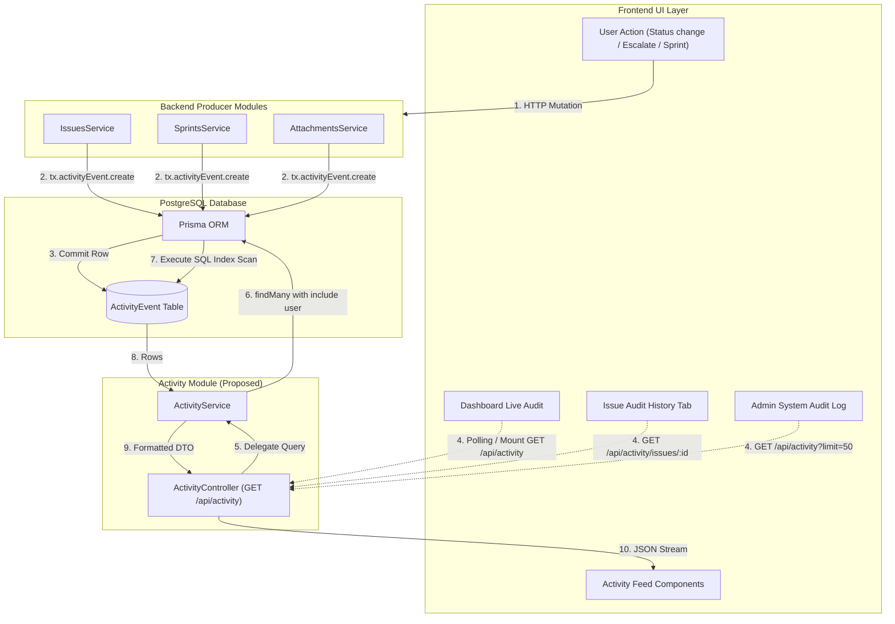
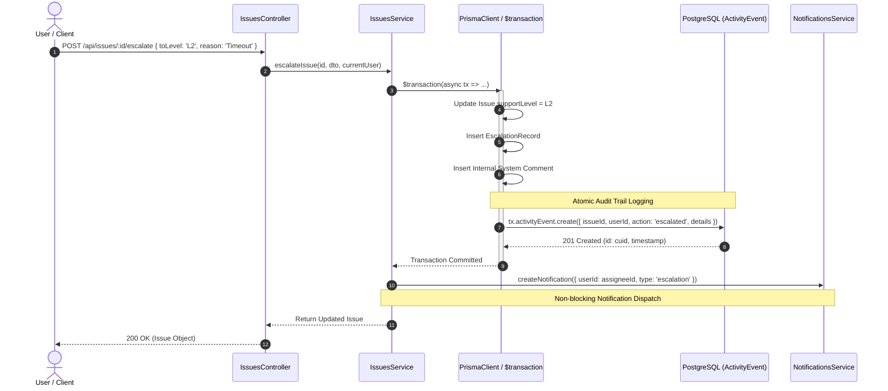

# Activity Module Specification

## Ticketing Management Platform (Inbox / GoldMine Portal)

---

## 1. Document Overview & Audit Status

### 1.1 Purpose and Scope

This document establishes the authoritative, implementation-ready architectural and functional specification for the **Activity Module (`ActivityModule`)** within the **Ticketing Management Platform (Inbox / GoldMine Portal)**.

The Activity Module governs the immutable forensic audit trail, workspace event streaming, and entity change history across the ticketing, agile sprint, support escalation, and collaboration lifecycle. It enables system administrators, engineering leads, project managers, customer support agents, and auditors to inspect an immutable chronological ledger of state mutations—such as ticket creations, status transitions, SLA escalations (L1 $\to$ L2 $\to$ L3), comments, file attachments, and sprint ceremonies—across individual issues, projects, and the global workspace.

### 1.2 Documentation Authority Hierarchy

This specification strictly adheres to the established project documentation hierarchy:

```
┌─────────────────────────────────────────────────────────────┐
│ 1. BACKEND_ARCHITECTURE.md (Immutable Foundational Source)   │
└──────────────────────────────┬──────────────────────────────┘
                               │
┌──────────────────────────────▼──────────────────────────────┐
│ 2. docs/01_SYSTEM_ARCHITECTURE.md (System Topology & Sec)   │
└──────────────────────────────┬──────────────────────────────┘
                               │
┌──────────────────────────────▼──────────────────────────────┐
│ 3. docs/02_CODING_STANDARDS.md (TypeScript, DTO & Prisma)   │
└──────────────────────────────┬──────────────────────────────┘
                               │
┌──────────────────────────────▼──────────────────────────────┐
│ 4. docs/03_MODULE_IMPLEMENTATION.md (Tier 2 Roadmap)        │
└──────────────────────────────┬──────────────────────────────┘
                               │
┌──────────────────────────────▼──────────────────────────────┐
│ 5. ACTIVITY_MODULE.md (This Detailed Specification)         │
└─────────────────────────────────────────────────────────────┘
```

### 1.3 Repository Audit & Status Separation

To prevent ambiguity during development and review, all statements in this document are strictly categorized into five architectural tiers:

#### Tier 1: Existing and Verified (Physical Repository Truth)
* **Prisma Model**: `model ActivityEvent` is physically declared in [`backend/prisma/schema.prisma`](file:///c:/Users/kirit/ticketing_tool/backend/prisma/schema.prisma#L279-L294) with exactly 7 fields: `id`, `issueId`, `projectId`, `userId`, `action`, `details`, and `timestamp`.
* **Database Migrations**: Migration [`20261012111255_init/migration.sql`](file:///c:/Users/kirit/ticketing_tool/backend/prisma/migrations/20261012111255_init/migration.sql#L167-L177) compiles the `"ActivityEvent"` table, primary key `ActivityEvent_pkey`, foreign keys (`Issue(id)` with `ON DELETE CASCADE`, `Project(id)` with `ON DELETE CASCADE`, and `User(id)` with `ON DELETE RESTRICT`), and three single-column indexes: `"ActivityEvent_issueId_idx"`, `"ActivityEvent_projectId_idx"`, and `"ActivityEvent_timestamp_idx"`.
* **Verified Backend Event Triggers**: Multiple backend services already perform direct inserts into `prisma.activityEvent`:
  * [`backend/src/issues/issues.service.ts`](file:///c:/Users/kirit/ticketing_tool/backend/src/issues/issues.service.ts#L210-L218): Logs ticket creation (`action: 'created'`), status changes (`action: 'status_changed'`), tier escalations (`action: 'escalated'`), and comments (`action: 'comment_added'`).
  * [`backend/src/sprints/sprints.service.ts`](file:///c:/Users/kirit/ticketing_tool/backend/src/sprints/sprints.service.ts#L139-L150): Logs sprint creation (`action: 'sprint_created'`), sprint activation (`action: 'sprint_started'`), sprint closure (`action: 'sprint_completed'`), and sprint removal (`action: 'sprint_deleted'`) inside transactional blocks (`$transaction`).
  * [`backend/src/attachments/attachments.service.ts`](file:///c:/Users/kirit/ticketing_tool/backend/src/attachments/attachments.service.ts#L283-L295): Logs file uploads (`action: 'attachment_added'`) and deletions (`action: 'attachment_deleted'`) inside transactional blocks.
* **Frontend Type Definition**: `export interface ActivityEvent` is declared in [`frontend/src/types/index.ts`](file:///c:/Users/kirit/ticketing_tool/frontend/src/types/index.ts#L59-L67) matching the database model structure.
* **Frontend UI Surfaces**:
  * [`Dashboard.tsx`](file:///c:/Users/kirit/ticketing_tool/frontend/src/pages/Dashboard.tsx#L470-L504): Live Audit stream widget displays the latest 7 deduplicated activity items.
  * [`IssueDetailPage.tsx`](file:///c:/Users/kirit/ticketing_tool/frontend/src/pages/IssueDetailPage.tsx#L163-L167): Audit History tab filters events by `issueId` and renders chronological timeline cards.
  * [`AdminPanelPage.tsx`](file:///c:/Users/kirit/ticketing_tool/frontend/src/pages/AdminPanelPage.tsx#L1322-L1352): System Audit Log tab displays up to 30 recent workspace events with user badges and timestamps.

#### Tier 2: Partially Implemented
* **Frontend State & Storage**: [`AppContext.tsx`](file:///c:/Users/kirit/ticketing_tool/frontend/src/context/AppContext.tsx#L390-L403) provides a `logActivity` helper that generates client-side IDs (`act-${Date.now()}-${randomSuffix}`) and commits events into browser `localStorage` via [`storage.ts`](file:///c:/Users/kirit/ticketing_tool/frontend/src/services/storage.ts#L184-L201). However, the frontend does **not** yet consume or fetch activity events from the backend database via REST.
* **Format of `details` Field in Database**: Existing producer services write `details` in inconsistent formats: `issues.service.ts` writes plain human-readable strings (e.g., `"created ticket INB-1001 ..."`), while `sprints.service.ts` and `attachments.service.ts` write stringified JSON (`JSON.stringify({ ... })`).

#### Tier 3: Proposed (Design Required for Implementation)
* **Backend Dedicated Module**: Creation of `backend/src/activity/` containing `ActivityModule`, `ActivityController`, and `ActivityService`.
* **REST Endpoints**:
  * `GET /api/activity`: Global workspace and filtered activity stream with cursor/offset pagination.
  * `GET /api/activity/issues/:issueId`: Focused ticket audit history.
  * `GET /api/activity/projects/:projectId`: Project-level activity feed.
* **Structured Payload Helper**: A standardized `ActivityLoggerService` or static contract ensuring `details` can safely accommodate both structured change diffs and human-readable fallbacks.
* **Frontend Network Client**: `activityApi` in [`frontend/src/services/api.ts`](file:///c:/Users/kirit/ticketing_tool/frontend/src/services/api.ts) and network integration in [`AppContext.tsx`](file:///c:/Users/kirit/ticketing_tool/frontend/src/context/AppContext.tsx) to fetch and sync server activity.

#### Tier 4: Not Implemented
* Independent REST Controller and Service for Activity querying in `backend/src/`.
* Registration of `ActivityModule` in `backend/src/app.module.ts`.
* Server-side pagination, date-range filtering, and actor filtering for activity events.
* Automated E2E and unit tests for activity retrieval and access control.

#### Tier 5: Unable to Verify
* Specific archival or cold-storage policy for high-volume activity records exceeding 1,000,000 rows (deferred to operational infrastructure policies).

---

## 2. Module Responsibilities & System Boundaries

### 2.1 Core Responsibilities

The `ActivityModule` is an **append-only governance and forensic telemetry module**. Its responsibilities are strictly bounded:

```
┌───────────────────────────────────────────────────────────────────────────┐
│                           ActivityModule Core Scope                       │
├───────────────────────────────────────────────────────────────────────────┤
│ 1. Immutable Audit Ledger: Record irreversible state transitions.         │
│ 2. Telemetry Queries: Provide paginated, filtered event streams.          │
│ 3. Entity History: Supply ticket-level and project-level event timelines.  │
│ 4. Cross-Module Service: Provide an injectable service for domain modules.│
│ 5. Actor Attribution: Guarantee that the authenticated actor is captured. │
└───────────────────────────────────────────────────────────────────────────┘
```

#### Out of Scope (Delegated to Other Modules):
1. **User Alerts & Unread Badges**: Owned strictly by `NotificationsModule`. An activity record must **never** be treated as a user notification.
2. **State Mutation Execution**: Owned by domain modules (`IssuesModule`, `SprintsModule`, `ProjectsModule`). `ActivityModule` records what happened; it never performs the business update itself.
3. **Audit Record Mutation or Deletion**: Audit logs are legally and architecturally immutable. `ActivityModule` provides **no** `PUT`, `PATCH`, or `DELETE` endpoints.

### 2.2 Boundary: NotificationsModule vs. ActivityModule

The boundary between notifications and activity logs is absolute:

```
┌──────────────────────────────────────────────┬──────────────────────────────────────────────┐
│             NotificationsModule              │                ActivityModule                │
├──────────────────────────────────────────────┼──────────────────────────────────────────────┤
│ • Entity: Notification                       │ • Entity: ActivityEvent                      │
│ • Audience: Private user-facing alert inbox  │ • Audience: Public team audit telemetry      │
│ • Primary Subject: Recipient (target user)   │ • Primary Subject: Actor (performer user)    │
│ • Mutability: Mutable (read = false -> true) │ • Mutability: Strictly immutable append-only │
│ • Tenancy: Scoped strictly to current user   │ • Tenancy: Scoped to Issue, Project, or Sys  │
│ • Lifecycle: Ephemeral (pruned / dismissed)  │ • Lifecycle: Permanent legal & forensic log  │
│ • UI Surface: Topbar Bell & Dropdown Panel   │ • UI Surface: Dashboard, Ticket History, Log │
│ • State Mutation: Can mark read / clear      │ • State Mutation: Never editable / erasable  │
└──────────────────────────────────────────────┴──────────────────────────────────────────────┘
```

#### Detailed Boundary Matrix

| Characteristic | `Notification` | `ActivityEvent` |
|---|---|---|
| **Database Table** | `"Notification"` | `"ActivityEvent"` |
| **Primary Meaning of `userId`** | The **recipient** who must be alerted | The **actor** who executed the action |
| **Associated Entities** | `User` (mandatory), `Issue` (optional) | `User` (mandatory), `Project` (optional), `Issue` (optional) |
| **Read State Tracking** | `read: Boolean` (default: `false`) | None (records are never marked read) |
| **Database Indexes** | `@@index([userId, read])` | `@@index([issueId])`, `@@index([projectId])`, `@@index([timestamp])` |
| **User Deletion Rule** | `onDelete: Cascade` (alert deleted with user) | `onDelete: Restrict` (prevents erasing audit history) |
| **Frontend Consumers** | [`Topbar.tsx`](file:///c:/Users/kirit/ticketing_tool/frontend/src/components/layout/Topbar.tsx), [`NotificationPanel.tsx`](file:///c:/Users/kirit/ticketing_tool/frontend/src/components/topbar/NotificationPanel.tsx) | [`Dashboard.tsx`](file:///c:/Users/kirit/ticketing_tool/frontend/src/pages/Dashboard.tsx), [`IssueDetailPage.tsx`](file:///c:/Users/kirit/ticketing_tool/frontend/src/pages/IssueDetailPage.tsx), [`AdminPanelPage.tsx`](file:///c:/Users/kirit/ticketing_tool/frontend/src/pages/AdminPanelPage.tsx) |

---

## 3. Existing Implementation Audit

### 3.1 Existing Repository Inventory

| Item / File | Responsibility | Current Implementation Status | Verified Details & Gaps |
|---|---|---|---|
| [`backend/prisma/schema.prisma`](file:///c:/Users/kirit/ticketing_tool/backend/prisma/schema.prisma#L279) | Database Schema | **Existing and verified** | `model ActivityEvent` fully declared with relations to `Issue`, `Project`, and `User`. |
| [`backend/prisma/migrations/...`](file:///c:/Users/kirit/ticketing_tool/backend/prisma/migrations/20261012111255_init/migration.sql#L167) | PostgreSQL Table | **Existing and verified** | `"ActivityEvent"` table, PK, FKs, and 3 B-Tree indexes created in database. |
| [`backend/src/issues/issues.service.ts`](file:///c:/Users/kirit/ticketing_tool/backend/src/issues/issues.service.ts) | Producer Service | **Existing and verified** | Inserts `ActivityEvent` on `createIssue`, `updateStatus`, `escalateIssue`, and `addComment`. |
| [`backend/src/sprints/sprints.service.ts`](file:///c:/Users/kirit/ticketing_tool/backend/src/sprints/sprints.service.ts) | Producer Service | **Existing and verified** | Inserts `ActivityEvent` on `createSprint`, `startSprint`, `completeSprint`, and `deleteSprint`. |
| [`backend/src/attachments/attachments.service.ts`](file:///c:/Users/kirit/ticketing_tool/backend/src/attachments/attachments.service.ts) | Producer Service | **Existing and verified** | Inserts `ActivityEvent` on file upload and file deletion. |
| `backend/src/activity/` | Consumer Module | **Not implemented** | Directory does not exist. No controller or dedicated service. |
| `backend/src/app.module.ts` | Root Module | **Partially implemented** | Imports 8 domain modules, but `ActivityModule` is not yet registered. |
| [`frontend/src/types/index.ts`](file:///c:/Users/kirit/ticketing_tool/frontend/src/types/index.ts#L59) | TypeScript Types | **Existing and verified** | `export interface ActivityEvent` matches schema. |
| [`frontend/src/services/storage.ts`](file:///c:/Users/kirit/ticketing_tool/frontend/src/services/storage.ts#L184) | Local Storage Mock | **Existing and verified** | Provides `getActivity()` and `saveActivity()` with null checks and deduplication. |
| [`frontend/src/context/AppContext.tsx`](file:///c:/Users/kirit/ticketing_tool/frontend/src/context/AppContext.tsx#L390) | State Management | **Partially implemented** | Has `logActivity` helper, but holds events in client memory/localStorage. |
| [`frontend/src/services/api.ts`](file:///c:/Users/kirit/ticketing_tool/frontend/src/services/api.ts) | Network Client | **Not implemented** | No `activityApi` exported in API client. |
| [`frontend/src/pages/Dashboard.tsx`](file:///c:/Users/kirit/ticketing_tool/frontend/src/pages/Dashboard.tsx#L470) | UI View | **Existing and verified** | Renders live audit stream from `useApp().activity`. |
| [`frontend/src/pages/IssueDetailPage.tsx`](file:///c:/Users/kirit/ticketing_tool/frontend/src/pages/IssueDetailPage.tsx#L898) | UI View | **Existing and verified** | Renders "Audit History" timeline from `useApp().activity`. |
| [`frontend/src/pages/AdminPanelPage.tsx`](file:///c:/Users/kirit/ticketing_tool/frontend/src/pages/AdminPanelPage.tsx#L1328) | UI View | **Existing and verified** | Renders "System Audit Log" stream from `useApp().activity`. |

### 3.2 Confirmed Gaps and Structural Inconsistencies

1. **Gap 1: Missing Query Layer**: While backend services create records, there is no HTTP interface for clients to read them back from PostgreSQL. The frontend displays events from seed data and `localStorage`.
2. **Gap 2: Payload Inconsistency**:
   * `issues.service.ts` writes plain-text strings: `details: 'created ticket INB-1001 "Database sync error" (Priority: High, Level: L1)'`.
   * `sprints.service.ts` writes JSON: `details: JSON.stringify({ sprintId: id, name: sprint.name, ... })`.
   * `attachments.service.ts` writes JSON: `details: JSON.stringify({ attachmentId, filename, ... })`.
   * *Resolution*: The reading service must safely handle both plain-text strings and JSON-stringified payloads without crashing.
3. **Gap 3: Missing Project Updates & User Management Triggers**:
   * Project creation, updates, and user modifications currently log activity on the frontend only (`AppContext.tsx`), but do not yet trigger backend `activityEvent.create` entries.

---

## 4. Architecture and Component Table

The following table details every existing and proposed component comprising the Activity subsystem:

| Component / File | Physical Status | Responsibility | Input | Output | Dependencies |
|---|---|---|---|---|---|
| [`backend/prisma/schema.prisma`](file:///c:/Users/kirit/ticketing_tool/backend/prisma/schema.prisma) | **Existing and verified** | Defines persistent database schema, relations, and indexes. | N/A | Database Tables | Prisma CLI |
| `backend/src/activity/activity.module.ts` | **Proposed** | Module container declaring controllers, providers, and exports. | NestJS DI | NestJS Module | `PrismaModule` |
| `backend/src/activity/activity.controller.ts` | **Proposed** | REST controller handling HTTP GET requests and query validation. | `QueryActivityDto`, JWT | `ActivityEventResponseDto[]` | `ActivityService`, `JwtAuthGuard` |
| `backend/src/activity/activity.service.ts` | **Proposed** | Core business logic for querying, filtering, and standardizing activity logs. | Query filters, Actor ID | Formatted Activity Events | `PrismaService` |
| `backend/src/activity/dto/query-activity.dto.ts` | **Proposed** | Validation DTO for query parameters (issueId, projectId, limit, cursor). | Query string | Validated Query Object | `class-validator`, `class-transformer` |
| `backend/src/activity/dto/activity-event-response.dto.ts` | **Proposed** | Serialized response contract with embedded actor information. | Prisma Record | JSON Response | `@prisma/client` |
| [`backend/src/issues/issues.service.ts`](file:///c:/Users/kirit/ticketing_tool/backend/src/issues/issues.service.ts) | **Existing and verified** | Producer: Logs issue lifecycle events (create, status, escalate, comment). | Issue DTOs, Actor | `Issue` + `ActivityEvent` | `PrismaService` |
| [`backend/src/sprints/sprints.service.ts`](file:///c:/Users/kirit/ticketing_tool/backend/src/sprints/sprints.service.ts) | **Existing and verified** | Producer: Logs sprint lifecycle events (create, start, complete, delete). | Sprint DTOs, Actor | `Sprint` + `ActivityEvent` | `PrismaService` |
| [`backend/src/attachments/attachments.service.ts`](file:///c:/Users/kirit/ticketing_tool/backend/src/attachments/attachments.service.ts) | **Existing and verified** | Producer: Logs attachment uploads and deletions. | Multipart file, Actor | `Attachment` + `ActivityEvent` | `PrismaService` |
| `frontend/src/services/api.ts` (`activityApi`) | **Proposed** | Client HTTP adapter for querying activity endpoints. | Filter params, JWT | `Promise<ActivityEvent[]>` | `fetchClient` |
| [`frontend/src/context/AppContext.tsx`](file:///c:/Users/kirit/ticketing_tool/frontend/src/context/AppContext.tsx) | **Partially implemented** | React global state managing `activity[]` array and live updates. | API response | Context state | `storage.ts`, `api.ts` |
| [`frontend/src/pages/Dashboard.tsx`](file:///c:/Users/kirit/ticketing_tool/frontend/src/pages/Dashboard.tsx) | **Existing and verified** | Consumer: Renders top 7 live workspace activity items. | `AppContext.activity` | Rendered Widget | React 19, Lucide Icons |
| [`frontend/src/pages/IssueDetailPage.tsx`](file:///c:/Users/kirit/ticketing_tool/frontend/src/pages/IssueDetailPage.tsx) | **Existing and verified** | Consumer: Renders issue-specific audit history tab. | `AppContext.activity` | Rendered Timeline | React 19 |
| [`frontend/src/pages/AdminPanelPage.tsx`](file:///c:/Users/kirit/ticketing_tool/frontend/src/pages/AdminPanelPage.tsx) | **Existing and verified** | Consumer: Renders system-wide audit event table for administrators. | `AppContext.activity` | Rendered Table | React 19 |

---

## 5. Activity Data Model

### 5.1 Authoritative Prisma Schema

The physical database model declared in [`backend/prisma/schema.prisma`](file:///c:/Users/kirit/ticketing_tool/backend/prisma/schema.prisma#L279-L294) is:

```prisma
model ActivityEvent {
  id        String   @id @default(cuid())
  issueId   String?
  issue     Issue?   @relation(fields: [issueId], references: [id], onDelete: Cascade)
  projectId String?
  project   Project? @relation(fields: [projectId], references: [id], onDelete: Cascade)
  userId    String
  user      User     @relation(fields: [userId], references: [id])
  action    String
  details   String
  timestamp DateTime @default(now())

  @@index([issueId])
  @@index([projectId])
  @@index([timestamp])
}
```

### 5.2 Field Definitions & Constraints

| Field | Database Type | Nullable | Default | Description & Constraint |
|---|---|---|---|---|
| `id` | `TEXT` (`VARCHAR`) | No | `cuid()` | Primary key. Collision-resistant unique identifier (e.g., `cmvf...`). |
| `issueId` | `TEXT` | **Yes** | `null` | Foreign key referencing `Issue(id)`. Format: `"INB-1001"`. Cascades on issue delete. |
| `projectId` | `TEXT` | **Yes** | `null` | Foreign key referencing `Project(id)`. CUID. Cascades on project delete. |
| `userId` | `TEXT` | No | None | Foreign key referencing `User(id)` representing the **actor**. Enforces `ON DELETE RESTRICT`. |
| `action` | `TEXT` | No | None | Standardized verb describing the mutation (e.g., `'created'`, `'status_changed'`). |
| `details` | `TEXT` | No | None | Free-form human text or JSON-stringified metadata describing the state delta. |
| `timestamp` | `TIMESTAMP(3)` | No | `now()` | UTC date-time of event generation. Indexed for chronological sorting. |

### 5.3 Referential Integrity and Deletion Rules

1. **Cascade on Project Deletion (`onDelete: Cascade`)**:
   * When a `Project` is permanently deleted, all associated `ActivityEvent` records referencing that `projectId` are automatically deleted by PostgreSQL.
2. **Cascade on Issue Deletion (`onDelete: Cascade`)**:
   * When an `Issue` is permanently deleted, all ticket-specific `ActivityEvent` records are removed.
3. **Restricted on User Deletion (`onDelete: Restrict`)**:
   * When an administrator attempts to delete a `User` from the database, PostgreSQL **aborts and rejects** the deletion if any `ActivityEvent` records reference that `User.id` as the actor.
   * *Rationale*: Audit logs must maintain strict forensic integrity. To retire a team member, their account must be updated to `status: UserStatus.Offline` or deactivated, preserving historical actor attribution.

### 5.4 Database Indexes

The table utilizes three dedicated B-Tree indexes:
1. `CREATE INDEX "ActivityEvent_issueId_idx" ON "ActivityEvent"("issueId");`
   * Accelerates ticket history lookups on [`IssueDetailPage.tsx`](file:///c:/Users/kirit/ticketing_tool/frontend/src/pages/IssueDetailPage.tsx).
2. `CREATE INDEX "ActivityEvent_projectId_idx" ON "ActivityEvent"("projectId");`
   * Accelerates project cockpit activity queries on [`ProjectDetailPage.tsx`](file:///c:/Users/kirit/ticketing_tool/frontend/src/pages/ProjectDetailPage.tsx).
3. `CREATE INDEX "ActivityEvent_timestamp_idx" ON "ActivityEvent"("timestamp");`
   * Optimizes chronological ordering (`ORDER BY timestamp DESC`) for workspace feeds.

---

## 6. Activity Event Catalogue

The following catalog documents every business event capable of generating an `ActivityEvent`, cross-referencing verified implementations against proposed extensions:

| Event Identifier (`action`) | Triggering Action | Actor (`userId`) | Entity References | Generated Details Format | Status | Source File / Module |
|---|---|---|---|---|---|---|
| `created` | User creates a new ticket | Current User | `issueId`, `projectId` | `created ticket {id} "{title}" (Priority: {p}, Level: {l})` | **Existing & verified** | `issues.service.ts` |
| `status_changed` | User drags board card or updates status | Current User | `issueId`, `projectId` | `moved {id} from {oldStatus} to {newStatus}` | **Existing & verified** | `issues.service.ts` |
| `escalated` | User escalates support tier (L1 $\to$ L2 $\to$ L3) | Current User | `issueId`, `projectId` | `escalated {id} {from} -> {to} (Reason: {reason})` | **Existing & verified** | `issues.service.ts` |
| `comment_added` | User posts public or internal comment | Current User | `issueId`, `projectId` | `posted {type} comment on {issueId}` | **Existing & verified** | `issues.service.ts` |
| `attachment_added` | User uploads file to ticket | Current User | `issueId` | `{"attachmentId":"...","filename":"...","fileSize":1234}` | **Existing & verified** | `attachments.service.ts` |
| `attachment_deleted` | User removes attachment | Current User | `issueId` | `{"attachmentId":"...","filename":"...","deletedBy":"..."}` | **Existing & verified** | `attachments.service.ts` |
| `sprint_created` | User creates planned sprint | Current User | `projectId` | `{"sprintId":"...","name":"...","startDate":"..."}` | **Existing & verified** | `sprints.service.ts` |
| `sprint_started` | User activates planned sprint | Current User | `projectId` | `{"sprintId":"...","name":"...","startedAt":"..."}` | **Existing & verified** | `sprints.service.ts` |
| `sprint_completed` | User completes active sprint & rolls over | Current User | `projectId` | `{"sprintId":"...","name":"...","completedAt":"..."}` | **Existing & verified** | `sprints.service.ts` |
| `sprint_deleted` | User deletes sprint container | Current User | `projectId` | `{"sprintId":"...","name":"...","deletedAt":"..."}` | **Existing & verified** | `sprints.service.ts` |
| `priority_changed` | User updates ticket priority | Current User | `issueId`, `projectId` | `changed priority of {id} from "{old}" to "{new}"` | **Partially implemented** (Frontend only) | `AppContext.tsx` |
| `assigned` | User reassigns ticket to new team member | Current User | `issueId`, `projectId` | `assigned {id} to {assigneeName}` | **Partially implemented** (Frontend only) | `AppContext.tsx` |
| `deleted` | User deletes ticket | Current User | `issueId`, `projectId` | `deleted issue {id} "{title}"` | **Partially implemented** (Frontend only) | `AppContext.tsx` |
| `project_created` | Administrator creates new project | Current User | `projectId` | `created project "{name}" ({key})` | **Partially implemented** (Frontend only) | `AppContext.tsx` |
| `project_updated` | Lead edits project metadata | Current User | `projectId` | `updated project "{name}"` | **Partially implemented** (Frontend only) | `AppContext.tsx` |
| `user_created` | Administrator invites new team member | Admin User | None | `created user account for "{name}" ({email})` | **Proposed** | `UsersService` |
| `user_role_changed` | Administrator promotes or demotes user | Admin User | None | `changed role of "{name}" to {role}` | **Proposed** | `UsersService` |

---

## 7. API Endpoint Specification

To expose the database activity events to the frontend in conformance with `BACKEND_ARCHITECTURE.md` Section 9 and `docs/03_MODULE_IMPLEMENTATION.md`, the following REST endpoints are specified:

### 7.1 Master Endpoint Table

| HTTP Method | Endpoint | Purpose | Auth Required | Request DTO | Success Response | Status | Expected Errors |
|---|---|---|---|---|---|---|---|
| `GET` | `/api/activity` | Retrieve workspace activity stream with filters & pagination | Bearer JWT | `QueryActivityDto` | `ActivityFeedResponseDto` | **Proposed** | `400 Bad Request`, `401 Unauthorized` |
| `GET` | `/api/activity/issues/:issueId` | Retrieve audit history for a single ticket | Bearer JWT | Query: `limit`, `cursor` | `ActivityEvent[]` | **Proposed** | `401 Unauthorized`, `404 Not Found` |
| `GET` | `/api/activity/projects/:projectId` | Retrieve activity feed for a project cockpit | Bearer JWT | Query: `limit`, `cursor` | `ActivityEvent[]` | **Proposed** | `401 Unauthorized`, `404 Not Found` |

### 7.2 Detailed Endpoint Contracts

#### 1. `GET /api/activity`

* **Description**: Queries workspace activity events ordered newest first (`ORDER BY timestamp DESC`). Supports multi-attribute filtering by actor, project, issue, action, and pagination.
* **Authentication**: Required (`JwtAuthGuard`).
* **Query Parameters (`QueryActivityDto`)**:

| Parameter | Type | Required | Default | Validation & Rules |
|---|---|---|---|---|
| `projectId` | `string` | No | `undefined` | Must be a valid Project CUID. |
| `issueId` | `string` | No | `undefined` | Must match issue key pattern (e.g., `INB-1001`). |
| `userId` | `string` | No | `undefined` | Filter events performed by specific actor. |
| `action` | `string` | No | `undefined` | Filter by event verb (e.g., `'created'`, `'escalated'`). |
| `limit` | `number` | No | `20` | Minimum `1`, maximum `100`. |
| `cursor` | `string` | No | `undefined` | ID of the last item from the previous page for keyset pagination. |

* **Request Example**:
```http
GET /api/activity?projectId=cmv7zh6ip0009bkyszbwpesb9&limit=10 HTTP/1.1
Host: localhost:4000
Authorization: Bearer <JWT_TOKEN>
```

* **Success Response (`200 OK`)**:
```json
{
  "items": [
    {
      "id": "cmvf2u7rf0051bkjkx06p8sub",
      "issueId": "INB-1004",
      "projectId": "cmv7zh6ip0009bkyszbwpesb9",
      "userId": "user-3",
      "action": "escalated",
      "details": "escalated INB-1004 L1 -> L3 (Reason: Critical production database block)",
      "timestamp": "2026-10-19T09:53:44.140Z",
      "user": {
        "id": "user-3",
        "name": "Priya Patel",
        "email": "priya@inbox.GoldMine.io",
        "avatar": "https://images.unsplash.com/photo-1494790108377-be9c29b29330?w=150",
        "role": "Technical"
      },
      "issue": {
        "id": "INB-1004",
        "title": "Database connection pool exhaustion"
      }
    }
  ],
  "nextCursor": "cmvf2u7rf0051bkjkx06p8sub",
  "hasMore": true,
  "total": 142
}
```

* **Error Response Example (`400 Bad Request`)**:
```json
{
  "statusCode": 400,
  "message": [
    "limit must not be greater than 100",
    "limit must be an integer number"
  ],
  "error": "Bad Request",
  "timestamp": "2026-10-19T11:45:00.000Z",
  "path": "/api/activity?limit=500"
}
```

---

#### 2. `GET /api/activity/issues/:issueId`

* **Description**: Returns all audit entries directly attached to a specific issue, ordered chronologically (`timestamp ASC` or `DESC` via query).
* **Authentication**: Required (`JwtAuthGuard`).
* **Path Parameter**: `issueId`: String (e.g., `"INB-1001"`).
* **Success Response (`200 OK`)**:
```json
[
  {
    "id": "cmvf1a...",
    "issueId": "INB-1001",
    "projectId": "cmv7...",
    "userId": "user-1",
    "action": "created",
    "details": "created ticket INB-1001 \"SSL Certificate Expiry\" (Priority: High, Level: L1)",
    "timestamp": "2026-10-18T10:00:00.000Z",
    "user": {
      "id": "user-1",
      "name": "Tejas Chauhan",
      "avatar": ""
    }
  },
  {
    "id": "cmvf1b...",
    "issueId": "INB-1001",
    "projectId": "cmv7...",
    "userId": "user-2",
    "action": "status_changed",
    "details": "moved INB-1001 from Open to In Progress",
    "timestamp": "2026-10-18T11:30:00.000Z",
    "user": {
      "id": "user-2",
      "name": "Sneha Patel",
      "avatar": ""
    }
  }
]
```

---

## 8. Activity Feed Flow Diagram

The following Mermaid flowchart visualizes how real business actions produce audit entries and how frontend components retrieve and render them:



---

## 9. Activity Creation Sequence Diagram

The following sequence diagram depicts the chronological interactions among the Client, Business Service, Transaction Context, Database, and Activity Consumer:



---

## 10. Activity Retrieval and Pagination

### 10.1 Access Control and Data Filtering

* **Authentication Guard**: All retrieval endpoints require a valid JWT via `JwtAuthGuard`.
* **Workspace Visibility**: Activity events are scoped to workspace projects. If a user has role access to view an issue or project (governed by RBAC in `rbac.ts`), they are authorized to read the audit events associated with that entity.
* **Sensitive Information Redaction**: Activity records must **never** record passwords, tokens, API secrets, or credit card numbers in `details`.

### 10.2 Keyset (Cursor-Based) Pagination Strategy

To support high-velocity audit feeds without performance degradation, `ActivityService` implements keyset pagination based on `(timestamp, id)`:

```typescript
// Proposed Keyset Query Pattern in ActivityService
async getFeed(query: QueryActivityDto) {
  const limit = Math.min(query.limit || 20, 100);
  const where: Prisma.ActivityEventWhereInput = {};

  if (query.projectId) where.projectId = query.projectId;
  if (query.issueId) where.issueId = query.issueId;
  if (query.userId) where.userId = query.userId;
  if (query.action) where.action = query.action;

  const items = await this.prisma.activityEvent.findMany({
    take: limit + 1, // Fetch one extra to evaluate hasMore
    where,
    orderBy: { timestamp: 'desc' },
    cursor: query.cursor ? { id: query.cursor } : undefined,
    skip: query.cursor ? 1 : 0,
    include: {
      user: {
        select: { id: true, name: true, email: true, avatar: true, role: true },
      },
      issue: {
        select: { id: true, title: true },
      },
    },
  });

  let nextCursor: string | undefined = undefined;
  let hasMore = false;

  if (items.length > limit) {
    hasMore = true;
    const nextItem = items.pop();
    nextCursor = items[items.length - 1].id;
  }

  return { items, hasMore, nextCursor };
}
```

---

## 11. Authentication and Authorization (RBAC)

The platform defines 8 distinct user roles in [`backend/prisma/schema.prisma`](file:///c:/Users/kirit/ticketing_tool/backend/prisma/schema.prisma#L48-L57) and [`frontend/src/services/rbac.ts`](file:///c:/Users/kirit/ticketing_tool/frontend/src/services/rbac.ts#L27-L36):

1. `Admin`
2. `Project Manager`
3. `Engineer`
4. `Technical`
5. `Developer`
6. `QA`
7. `Support Agent`
8. `Viewer`

### 11.1 Activity Permission Matrix

| Operation / Surface | Permitted Roles | Authorization Mechanism |
|---|---|---|
| **View Issue Audit History** | All 8 Roles (`Admin` down to `Viewer`) | Authenticated session with access to Issue's Project |
| **View Project Activity Feed** | All 8 Roles (`Admin` down to `Viewer`) | Authenticated session with access to Project |
| **View Dashboard Live Audit Stream** | All 8 Roles (`Admin` down to `Viewer`) | Authenticated session (`JwtAuthGuard`) |
| **View System Audit Log (Admin Panel)** | `Admin` | `@Roles(UserRole.Admin)` + `RolesGuard` |
| **Export Forensic Audit CSV/JSON** | `Admin`, `Project Manager` | `@Roles(UserRole.Admin, UserRole.Project_Manager)` |
| **Direct Mutation / Deletion of Audit Logs** | **NONE** (Forbidden to all roles including Admin) | Architectural denial (No endpoints exist) |

---

## 12. Frontend Integration

### 12.1 Current State Analysis

* The frontend currently uses a dual approach:
  1. Initial data is seeded from [`INITIAL_ACTIVITY`](file:///c:/Users/kirit/ticketing_tool/frontend/src/data/seedData.ts#L1917) into `localStorage`.
  2. Local user actions invoke `logActivity(...)` in [`AppContext.tsx`](file:///c:/Users/kirit/ticketing_tool/frontend/src/context/AppContext.tsx#L390) which prepends events to the React state and writes to `localStorage`.
* **Issue**: If multiple users work concurrently or page reloads occur across browsers, client-created activity events are isolated to that browser's `localStorage` and not shared across the team.

### 12.2 Integration Plan for Server-Backed Activity

1. **API Client Extension**: Add `activityApi` to [`frontend/src/services/api.ts`](file:///c:/Users/kirit/ticketing_tool/frontend/src/services/api.ts):
```typescript
export const activityApi = {
  getActivity: (params?: { projectId?: string; issueId?: string; limit?: number }) =>
    fetchClient<ActivityEvent[]>('/activity', { params }),
  getIssueHistory: (issueId: string) =>
    fetchClient<ActivityEvent[]>(`/activity/issues/${issueId}`),
};
```
2. **Context Synchronization**: In `AppContext.tsx`, fetch `activityApi.getActivity()` upon successful session verification alongside users, projects, and notifications.
3. **Preventing Duplicate React Keys**:
   * All records from PostgreSQL provide stable, unique CUIDs (`item.id`).
   * When rendering lists in `Dashboard.tsx`, `IssueDetailPage.tsx`, and `AdminPanelPage.tsx`, continue using `key={item.id}` with the defensive deduplication filter:
```typescript
const uniqueActivity = useMemo(() => {
  if (!Array.isArray(activity)) return [];
  const seen = new Set<string>();
  return activity.filter(item => {
    if (!item || !item.id || seen.has(item.id)) return false;
    seen.add(item.id);
    return true;
  });
}, [activity]);
```

---

## 13. Error Handling

### 13.1 Error Response Envelope

All error responses from `ActivityModule` strictly conform to the global [`HttpExceptionFilter`](file:///c:/Users/kirit/ticketing_tool/backend/src/common/filters/http-exception.filter.ts) structure:

```json
{
  "statusCode": 404,
  "message": "Project with identifier cmv7... not found.",
  "error": "NotFoundException",
  "timestamp": "2026-10-19T11:50:00.000Z",
  "path": "/api/activity?projectId=cmv7..."
}
```

### 13.2 Error Matrix

| Scenario | HTTP Status | Exception Class | Reason / Mitigation |
|---|---|---|---|
| Missing or Expired JWT | `401 Unauthorized` | `UnauthorizedException` | Request lacks valid Bearer header. Client redirects to `/login`. |
| Non-Admin Access to System Audit Log | `403 Forbidden` | `ForbiddenException` | User role lacks `Admin` privilege. Handled by `RolesGuard`. |
| Invalid Query Parameters (e.g. `limit > 100`) | `400 Bad Request` | `BadRequestException` | ValidationPipe catches invalid bounds or malformed CUIDs. |
| Referencing Non-Existent Issue | `404 Not Found` | `NotFoundException` | `GET /api/activity/issues/XYZ` when issue `XYZ` does not exist. |
| Referencing Non-Existent Project | `404 Not Found` | `NotFoundException` | `GET /api/activity?projectId=XYZ` when project does not exist. |
| Database Connection Loss | `500 Internal Server Error` | `InternalServerErrorException` | Managed by global exception filter; hides raw SQL queries. |
| Empty Activity Results | `200 OK` | N/A | Return empty array `[]` or `{ items: [], hasMore: false }`. |

---

## 14. Security and Data Integrity

1. **Actor Integrity via Decorator**:
   * Event producers **must never** accept the actor ID from the HTTP request body (`req.body.userId`).
   * The actor ID is strictly extracted from the cryptographically verified JWT via `@CurrentUser() user: AuthenticatedUser`.
2. **Immutability by Design**:
   * No service method or controller endpoint exists to modify or delete rows in `ActivityEvent`.
   * Direct database triggers or read-only service wrappers prevent accidental updates.
3. **No Sensitive Data in Payloads**:
   * Event details must not capture passwords, password hashes, reset tokens, or session secrets.
   * User creation events record `name` and `email` only.
4. **Relational Safety on User Deletion**:
   * The foreign key constraint `ON DELETE RESTRICT` ensures that deleting a user account cannot silently delete or orphan forensic activity history.

---

## 15. Testing Requirements

### 15.1 Unit Tests (`backend/src/activity/activity.service.spec.ts`)
* Verify `ActivityService.findAll` returns events matching project filter.
* Verify `ActivityService.findAll` correctly applies keyset pagination limits.
* Verify `ActivityService.findByIssue` returns chronological ticket events.
* Verify proper handling of corrupt or malformed JSON strings in the `details` column without throwing exceptions.

### 15.2 Integration & API E2E Tests (`backend/test/activity.e2e-spec.ts`)
* Assert `GET /api/activity` returns `401 Unauthorized` when called without token.
* Assert `GET /api/activity` returns `200 OK` with valid JWT.
* Assert `GET /api/activity?limit=5` returns exactly 5 items and a valid `nextCursor`.
* Assert `GET /api/activity/issues/:id` returns 404 for unknown ticket ID.
* Verify that performing a status transition on an issue automatically creates an `ActivityEvent` record accessible via `GET /api/activity`.

### 15.3 Frontend Unit Tests (`frontend/src/pages/Dashboard.spec.tsx`)
* Verify `Dashboard` renders the live audit widget without errors when activity array is empty.
* Verify `Dashboard` deduplicates items with identical IDs.
* Verify graceful rendering of both plain-text and JSON-stringified activity details.

---

## 16. Implementation Order

The recommended sequence for implementing `ActivityModule` is structured by concrete dependencies:

| Step | Phase | Task Description | Prerequisites | Expected Deliverable |
|---|---|---|---|---|
| **1** | Backend Core | Create `backend/src/activity/dto/query-activity.dto.ts` | None | Validated DTO with class-validator rules |
| **2** | Backend Core | Create `backend/src/activity/activity.service.ts` | Step 1, `PrismaService` | Service with keyset pagination & relational includes |
| **3** | Backend Core | Create `backend/src/activity/activity.controller.ts` | Step 2, `JwtAuthGuard` | REST controller with `/api/activity` endpoints |
| **4** | Backend Core | Create `backend/src/activity/activity.module.ts` and register in `backend/src/app.module.ts` | Step 3 | Module compiled and exposed via NestJS dependency injection |
| **5** | Automated Tests | Create `backend/test/activity.e2e-spec.ts` | Step 4 | Passing E2E test suite verifying endpoints and auth |
| **6** | Frontend API | Add `activityApi` to `frontend/src/services/api.ts` | Step 4 | TypeScript client methods with proper typing |
| **7** | Frontend State | Update `AppContext.tsx` to fetch activity on mount | Step 6 | Global activity state hydrated from PostgreSQL |
| **8** | Frontend Polish | Verify `Dashboard.tsx`, `IssueDetailPage.tsx`, and `AdminPanelPage.tsx` | Step 7 | Real-time audit streams rendering live data |

---

## 17. Acceptance Criteria

`ActivityModule` implementation will be considered complete when all of the following criteria are satisfied:

1. **Module Registration**: `ActivityModule` is registered in `backend/src/app.module.ts` and boots without errors.
2. **REST Endpoints Operational**:
   * `GET /api/activity` returns HTTP 200 with an array/envelope of recent activity records.
   * `GET /api/activity/issues/:issueId` returns HTTP 200 with all activity events for the given issue.
   * `GET /api/activity/projects/:projectId` returns HTTP 200 with all activity events for the given project.
3. **Authentication Enforced**: Calling any activity endpoint without a valid Bearer token returns HTTP 401.
4. **Relational Includes**: Responses include nested user actor details (`id`, `name`, `email`, `avatar`, `role`).
5. **Producer Consistency**: Verified that ticket creation, status changes, tier escalations, comments, attachments, and sprint operations record persistent entries in `ActivityEvent`.
6. **Immutable Ledger**: No endpoints exist for `PUT`, `PATCH`, or `DELETE` on activity events.
7. **Frontend Synchronization**: Frontend feeds on the Dashboard, Issue Detail Page, and Admin Panel display live records from the database instead of static `localStorage` mocks.
8. **Test Suite Passes**: Automated E2E tests pass with 100% assertions satisfied.

---

## 18. Open Questions and Unresolved Decisions

1. **Activity Retention & Pruning Policy**:
   * *Question*: Should high-frequency activity records (e.g., ticket comments, status moves) be automatically archived or partitioned after 180 or 365 days, or retained indefinitely in the primary PostgreSQL table?
   * *Status*: Unresolved. Requires product and compliance approval before implementing background cleanup jobs.
2. **Standardization of the `details` Column**:
   * *Question*: Should existing plain-text details in `issues.service.ts` be migrated to structured JSON objects (e.g. `{ diff: { from: 'Open', to: 'In Progress' } }`), or should the schema continue supporting free-form text?
   * *Status*: Unresolved. Recommended: support JSON with fallback string parsing in the presentation layer.
3. **Real-time WebSockets / SSE**:
   * *Question*: Should activity events be pushed to connected clients via Server-Sent Events (SSE) or WebSockets for instantaneous dashboard updates without manual refreshing?
   * *Status*: Proposed for Phase 3 enhancement.

---

## 19. Final Documentation Checklist

- [x] Conforms to `BACKEND_ARCHITECTURE.md` Section 9 and `docs/03_MODULE_IMPLEMENTATION.md`.
- [x] References actual Prisma schema in `backend/prisma/schema.prisma` (`model ActivityEvent`).
- [x] Verified existing backend triggers in `issues.service.ts`, `sprints.service.ts`, and `attachments.service.ts`.
- [x] Clearly distinguishes between notifications (`NotificationsModule`) and audit history (`ActivityModule`).
- [x] Covers all 8 project user roles and RBAC rules.
- [x] Provides valid Mermaid flowchart and sequence diagram.
- [x] Includes complete endpoint contracts with JSON request and response examples.
- [x] Specifies keyset pagination and query filtering.
- [x] Details frontend consumption across `Dashboard.tsx`, `IssueDetailPage.tsx`, and `AdminPanelPage.tsx`.
- [x] Outlines unit, integration, and E2E testing criteria.
- [x] Outlines actionable, step-by-step implementation order.
- [x] Lists open questions and unverified assumptions without silent fabrication.
