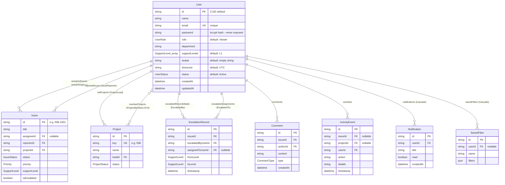
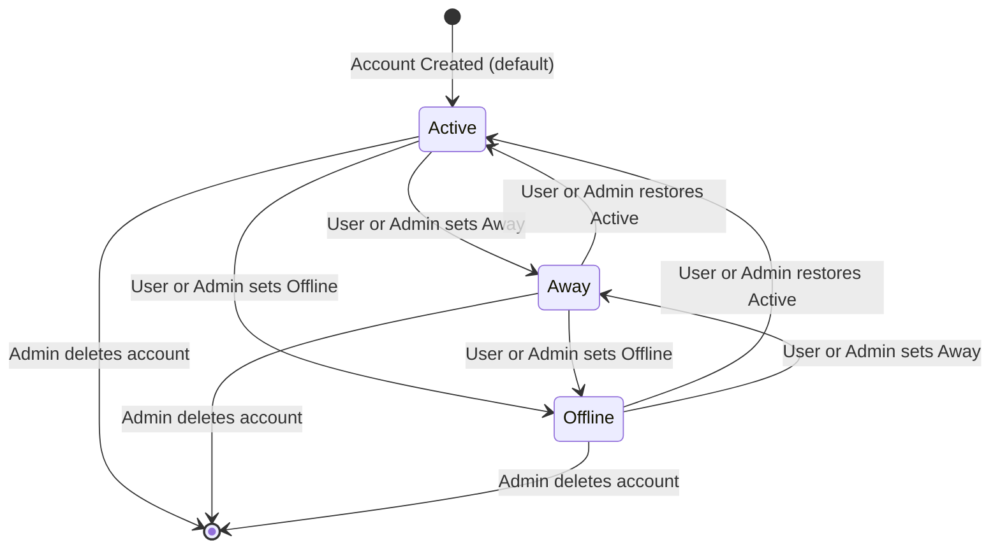
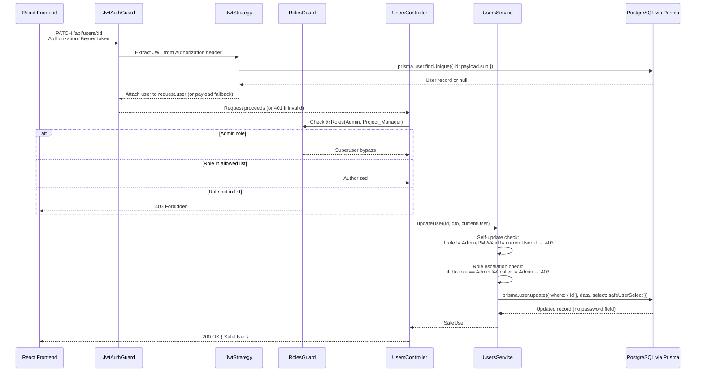
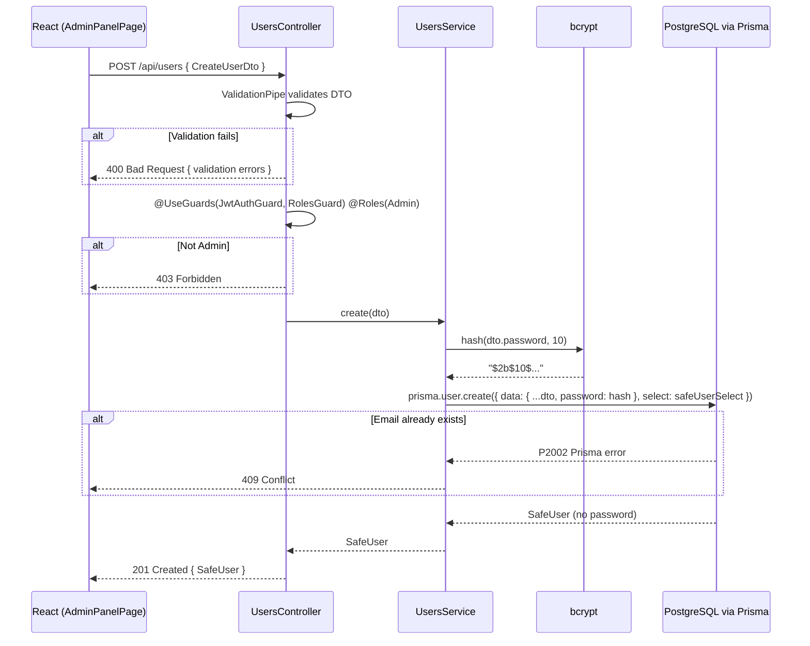

# Users Module Specification

## Ticketing Management Platform (Inbox / GoldMine Portal)

---

## 1. Module Overview and Objectives

### 1.1 Purpose

This document establishes the comprehensive, authoritative, implementation-ready specification for the **Users (`UsersModule`)** of the **Ticketing Management Platform** (known internally as the *Inbox / GoldMine Portal*). It provides exact architectural contracts, planned endpoint specifications, Data Transfer Object (DTO) schemas, database structure, RBAC matrix, validation rules, security controls, testing plans, and frontend integration contracts.

This specification is authored so that any backend engineer can implement the Users Module on an isolated workstation without architectural ambiguity, contract drift, or incompatibility with the existing React 19 frontend SPA.

### 1.2 System & Project Identity

| Property | Value |
|---|---|
| **System Name** | Ticketing Management Platform (Inbox / GoldMine Portal) |
| **Subsystem** | Planned Backend REST API (`backend/`) |
| **Module Name** | `UsersModule` |
| **NestJS Directory** | `backend/src/users/` |
| **API Base Path** | `/api/users` |
| **Tech Stack** | NestJS v10.x, TypeScript 5.x, bcrypt, PostgreSQL 16+, Prisma ORM v6.x |
| **Backend Port** | `4000` (via `PORT` env variable) |
| **Frontend Port** | `3000` (Vite dev server) |

### 1.3 Module Objectives

1. **User Lifecycle Management**: Provide full CRUD operations (Create, Read, Update, Delete) for user accounts persisted in PostgreSQL.
2. **Safe Data Exposure**: Ensure the `password` field is never returned in any API response by using a consistent `SafeUser` projection.
3. **Role-Based Access Control (RBAC)**: Restrict user management operations to authorized roles (`Admin`, `Project Manager`) while allowing profile self-service to authenticated users.
4. **Password Security**: Hash all passwords using `bcrypt` (10 salt rounds) before persistence. Support administrative password reset without returning hashed values.
5. **Frontend Compatibility**: Supply exactly the fields consumed by the frontend (`ProfilePage`, `AdminPanelPage`, `TeamPage`) without breaking existing behavior.
6. **Search, Filtering & Pagination**: Provide query parameters for filtering by role, department, support level, and status; support pagination for large user directories.
7. **Auth Module Integration**: Reuse the existing `JwtAuthGuard`, `RolesGuard`, `@CurrentUser()`, and `@Roles()` decorators from `src/common/`.

### 1.4 Scope

This document covers:

- The `User` database model as defined in `backend/prisma/schema.prisma`.
- All planned REST API endpoints for the Users Module.
- Create, Update, and Password Reset DTO schemas with full validation rules.
- Role-Based Access Control (RBAC) matrix for all 8 roles.
- Integration contracts with the existing `AuthModule`.
- Frontend-to-backend API mapping for `ProfilePage`, `AdminPanelPage`, and `TeamPage`.
- Error handling, HTTP status codes, and the Prisma exception filter behavior.
- Postman testing plan with 25 test cases.
- Implementation steps and acceptance criteria.

### 1.5 Out of Scope

- Implementation of the `AuthModule` (fully documented in `AUTH_MODULE.md`).
- File upload handling for `avatar` (URL-based avatar is the current standard; file upload is a future enhancement).
- OAuth2 / SSO integration (not in the current architecture).
- Email verification or password recovery via email (not in current scope).

### 1.6 Authoritative Documentation Hierarchy

1. `BACKEND_ARCHITECTURE.md` — Immutable system design baseline.
2. `docs/01_SYSTEM_ARCHITECTURE.md` — Macro architectural blueprint.
3. `docs/02_CODING_STANDARDS.md` — Micro engineering standards.
4. `docs/modules/AUTH_MODULE.md` — Authentication module specification.
5. `backend/prisma/schema.prisma` — Authoritative database schema (source of truth).

---

## 2. Scope and Functional Requirements

### 2.1 Functional Requirements

| ID | Requirement | Priority |
|---|---|---|
| USR-F01 | Admin can create a new user with all required fields | MUST |
| USR-F02 | Admin can retrieve a paginated list of all users | MUST |
| USR-F03 | Any authenticated user can retrieve a specific user by ID | MUST |
| USR-F04 | Admin and Project Manager can update any user's profile fields | MUST |
| USR-F05 | Any authenticated user can update their own profile (self-service) | MUST |
| USR-F06 | Admin can reset any user's password | MUST |
| USR-F07 | Authenticated user can change their own password | MUST |
| USR-F08 | Admin can delete a user account | MUST |
| USR-F09 | Password field MUST never appear in any API response | MUST |
| USR-F10 | All passwords MUST be stored as bcrypt hashes (10 rounds) | MUST |
| USR-F11 | User list supports filtering by `role`, `department`, `status`, `supportLevel` | SHOULD |
| USR-F12 | User list supports full-text `search` on `name` and `email` | SHOULD |
| USR-F13 | User list supports offset pagination | SHOULD |
| USR-F14 | Email must be globally unique across the system | MUST |
| USR-F15 | Admin cannot be deleted if they are the last Admin account | SHOULD |

### 2.2 Non-Functional Requirements

| ID | Requirement | Standard |
|---|---|---|
| USR-NF01 | Password hashing via bcrypt | 10 salt rounds |
| USR-NF02 | All endpoints protected by `JwtAuthGuard` | Bearer token required |
| USR-NF03 | Response latency for user list (< 500 users) | < 200 ms |
| USR-NF04 | TypeScript strict mode enforced | `strict: true` in `tsconfig.json` |
| USR-NF05 | Validation via `class-validator` DTOs | Global `ValidationPipe` with `whitelist: true` |
| USR-NF06 | Error responses follow uniform JSON contract | `HttpExceptionFilter` + `PrismaExceptionFilter` |

---

## 3. Frontend Analysis and User Interface Requirements

### 3.1 Frontend Pages That Consume User Data

The following pages in `frontend/src/pages/` interact with user data, analyzed directly from source code.

#### 3.1.1 AdminPanelPage.tsx — User Management Tab

**Source**: `frontend/src/pages/AdminPanelPage.tsx` (lines 48–242)

**Operations performed**:
- Lists all users in a management table with inline search filtering
- **Add User** modal captures: `name`, `email`, `role` (enum dropdown), `department`, `password`, `supportLevels` (multi-select toggle)
- **Edit User** modal updates: `name`, `email`, `role`, `department`, `password`, `supportLevels`
- **Password Reset**: Separate inline password editor per user (frontend enforces minimum 4 characters)
- **Delete User**: Confirmed via `ConfirmModal`

**Default values used when creating a user** (from source lines 192–195):

```typescript
role: 'Support Agent'
department: 'Customer Support'
password: 'welcome123'
supportLevels: ['L1']
avatar: auto-generated Unsplash URL
timezone: 'UTC+05:30 (IST)'
status: 'Active'
```

#### 3.1.2 TeamPage.tsx — Team Directory

**Source**: `frontend/src/pages/TeamPage.tsx` (lines 17–320)

**Operations performed**:
- Displays user cards grid with: `name`, `email`, `role`, `avatar`, `supportLevels`, open/assigned issue counts
- **Add Member** form captures: `name`, `email`, `role` (free-text input — see conflict note below), `supportLevels`
- **Edit Member** updates: `name`, `email`, `role`, `supportLevels`
- **Switch User** (development demo): Changes active session user locally

**Conflict**: `TeamPage` uses a free-text `<input>` for `role`, while the backend MUST enforce enum validation. See Section 23.2.

#### 3.1.3 ProfilePage.tsx — Self-Service Profile

**Source**: `frontend/src/pages/ProfilePage.tsx` (lines 18–211)

**Operations performed**:
- Displays current user's: `name`, `email`, `role`, `avatar`, `supportLevels`, issue metrics (open, resolved, breached)
- Editable fields: `name`, `email`, `role`, `avatar` (URL), `supportLevels`
- **Save Profile** submits a partial update for the authenticated user via `updateUser(currentUser.id, { ... })`

#### 3.1.4 LoginPage.tsx — Authentication

Handled entirely by **AuthModule**. Not in scope for `UsersModule`.

### 3.2 Frontend User Type Definition

**Source**: `frontend/src/types/index.ts` (lines 110–121) — **Existing**

```typescript
export interface User {
  id: string;
  name: string;
  email: string;
  password?: string;           // Optional — only used locally in AdminPanel mock
  role: UserRole;
  department: string;
  supportLevels: SupportLevel[];  // e.g. ['L1'], ['L2'], ['L1', 'L2']
  avatar: string;
  timezone: string;
  status: 'Active' | 'Away' | 'Offline';
}
```

> **Important**: The frontend `User` interface includes an optional `password` field used only in `localStorage`-based mock storage (`storage.ts`). The backend **MUST NOT** return the `password` field in any API response.

### 3.3 Frontend Role Constants

**Source**: `frontend/src/services/rbac.ts` (lines 27–36) — **Existing**

```typescript
export const ALL_ROLES: UserRole[] = [
  'Admin', 'Project Manager', 'Engineer', 'Technical',
  'Developer', 'QA', 'Support Agent', 'Viewer',
];
```

These map exactly to the `UserRole` enum in `schema.prisma` (with `@map()` directives for multi-word values).

### 3.4 Existing Frontend API Integration

**Source**: `frontend/src/services/api.ts` — **Existing, partial**

The frontend API client currently implements only auth endpoints:
- `POST /auth/login` → `authApi.login()`
- `GET /auth/me` → `authApi.getMe()`
- `POST /auth/logout` → `authApi.logout()`

**Users Module API calls are NOT yet implemented** in `api.ts`. Section 19.1 documents the planned `usersApi` functions to be added.

---

## 4. Existing Architecture and Dependencies

### 4.1 Current Codebase Status Audit

| Artifact | Path | Status | Evidence |
|---|---|---|---|
| Prisma User Model | `backend/prisma/schema.prisma` | ✅ Existing | Lines 103–131, complete User model |
| UserRole Enum | `backend/prisma/schema.prisma` | ✅ Existing | Lines 48–57, 8 roles defined |
| UserStatus Enum | `backend/prisma/schema.prisma` | ✅ Existing | Lines 59–63 |
| SupportLevel Enum | `backend/prisma/schema.prisma` | ✅ Existing | Lines 42–46 |
| SafeUser Interface | `backend/src/auth/auth.service.ts` | ✅ Existing | Lines 8–20 |
| JwtAuthGuard | `backend/src/common/guards/jwt-auth.guard.ts` | ✅ Existing | Full implementation |
| RolesGuard | `backend/src/common/guards/roles.guard.ts` | ✅ Existing | Admin bypass on line 20 |
| @Roles() Decorator | `backend/src/common/decorators/roles.decorator.ts` | ✅ Existing | Full implementation |
| @CurrentUser() Decorator | `backend/src/common/decorators/current-user.decorator.ts` | ✅ Existing | Full implementation |
| @Public() Decorator | `backend/src/common/decorators/public.decorator.ts` | ✅ Existing | Full implementation |
| HttpExceptionFilter | `backend/src/common/filters/http-exception.filter.ts` | ✅ Existing | Full implementation |
| PrismaExceptionFilter | `backend/src/common/filters/prisma-exception.filter.ts` | ✅ Existing | Handles P2002, P2025, P2003 |
| PrismaService | `backend/src/prisma/` | ✅ Existing | Registered globally |
| AuthModule | `backend/src/auth/` | ✅ Existing | Exports JwtModule, PassportModule, JwtStrategy |
| UsersModule | `backend/src/users/` | ⚠️ Placeholder | Directory exists with only `.gitkeep` |
| UsersController | `backend/src/users/users.controller.ts` | ❌ Not Implemented | Needs to be created |
| UsersService | `backend/src/users/users.service.ts` | ❌ Not Implemented | Needs to be created |
| Users DTOs | `backend/src/users/dto/` | ❌ Not Implemented | Needs to be created |

### 4.2 Dependencies the UsersModule Must Consume

```typescript
// Required imports in users.module.ts
import { PrismaModule } from '../prisma/prisma.module';   // Global, always available
import { AuthModule } from '../auth/auth.module';          // For JwtModule + PassportModule
```

> **Note**: `JwtAuthGuard` is currently **NOT registered globally** in `AppModule`. Each module must apply `@UseGuards(JwtAuthGuard)` explicitly, or `AppModule` must be updated to register it globally using `APP_GUARD`. See Open Question OQ-1 in Section 23.

### 4.3 AppModule Registration Requirement

When `UsersModule` is created, it MUST be registered in `backend/src/app.module.ts`. This is documentation only — no code changes are made in this task.

---

## 5. User Data Model and Database Table Structure

### 5.1 Prisma Schema — User Model

**Source**: `backend/prisma/schema.prisma` (lines 103–131) — **Existing**

```prisma
model User {
  id            String         @id @default(cuid())
  name          String
  email         String         @unique
  password      String         // bcrypt hashed
  role          UserRole       @default(Viewer)
  department    String
  supportLevels SupportLevel[] @default([L1])
  avatar        String         @default("")
  timezone      String         @default("UTC")
  status        UserStatus     @default(Active)
  createdAt     DateTime       @default(now())
  updatedAt     DateTime       @updatedAt

  assignedIssues        Issue[]            @relation("IssueAssignee")
  reportedIssues        Issue[]            @relation("IssueReporter")
  escalatedRecordsMade  EscalationRecord[] @relation("EscalatedBy")
  escalatedAssignments  EscalationRecord[] @relation("EscalatedTo")
  comments              Comment[]
  ledProjects           Project[]          @relation("ProjectLead")
  memberProjects        Project[]          @relation("ProjectMembers")
  activities            ActivityEvent[]
  notifications         Notification[]
  savedFilters          SavedFilter[]

  @@index([role])
  @@index([email])
}
```

### 5.2 Database Field Reference Table

| Field | Prisma Type | PostgreSQL Type | Nullable | Default | Description |
|---|---|---|---|---|---|
| `id` | `String` | `TEXT` (CUID) | No | `cuid()` | Primary key |
| `name` | `String` | `TEXT` | No | — | Full display name |
| `email` | `String` | `TEXT` | No | — | Unique login identifier |
| `password` | `String` | `TEXT` | No | — | bcrypt hash — never returned in API |
| `role` | `UserRole` | `ENUM` | No | `Viewer` | RBAC role (8 values) |
| `department` | `String` | `TEXT` | No | — | Organizational department |
| `supportLevels` | `SupportLevel[]` | `TEXT[]` | No | `{L1}` | Assigned support tiers |
| `avatar` | `String` | `TEXT` | No | `""` | Avatar image URL |
| `timezone` | `String` | `TEXT` | No | `"UTC"` | Timezone string (free-text) |
| `status` | `UserStatus` | `ENUM` | No | `Active` | Presence/availability state |
| `createdAt` | `DateTime` | `TIMESTAMPTZ` | No | `now()` | Account creation timestamp |
| `updatedAt` | `DateTime` | `TIMESTAMPTZ` | No | auto | Last update (Prisma-managed) |

### 5.3 Enum Definitions (Existing in Schema)

#### UserRole Enum (schema.prisma lines 48–57)

| Prisma Value | DB Mapped Value | Description |
|---|---|---|
| `Admin` | `Admin` | Super-administrator — full system access |
| `Project_Manager` | `Project Manager` | Project lead — team and sprint management |
| `Developer` | `Developer` | Software developer |
| `QA` | `QA` | Quality assurance engineer |
| `Support_Agent` | `Support Agent` | L1 frontline customer support |
| `Technical` | `Technical` | L2 technical support/operations |
| `Engineer` | `Engineer` | L3 core platform engineering |
| `Viewer` | `Viewer` | Read-only access |

#### UserStatus Enum (schema.prisma lines 59–63)

| Value | Description |
|---|---|
| `Active` | Online and available |
| `Away` | Temporarily unavailable |
| `Offline` | Not available |

#### SupportLevel Enum (schema.prisma lines 42–46)

| Value | Description |
|---|---|
| `L1` | Frontline customer support |
| `L2` | Technical escalation support |
| `L3` | Engineering-level escalation |

### 5.4 Safe User Projection (API Response Shape)

The `SafeUser` interface defined in `backend/src/auth/auth.service.ts` (lines 8–20) is the standard response shape. The `UsersModule` MUST reuse this same interface:

```typescript
// Existing in: backend/src/auth/auth.service.ts
export interface SafeUser {
  id: string;
  name: string;
  email: string;
  role: UserRole;
  department: string;
  supportLevels: SupportLevel[];
  avatar: string;
  timezone: string;
  status: UserStatus;
  createdAt?: Date;
  updatedAt?: Date;
}
```

---

## 6. Entity Relationship (ER) Diagram



---

## 7. User Roles and Role-Based Access Control (RBAC)

### 7.1 Role Hierarchy

The RBAC system is a flat-role model with one implicit superuser:

```
Admin  ─────────────────────── Full access (superuser bypass in RolesGuard)
Project Manager ────────────── User mgmt, projects, settings, reports
Engineer ───────────────────── L3 support, issues, projects, board
Technical ──────────────────── L2 support, issues, board
Developer ──────────────────── Issues, board, backlog, projects
QA ─────────────────────────── Issues, board, backlog, reports
Support Agent ──────────────── L1 support, issues, tickets
Viewer ─────────────────────── Read-only dashboard, team directory
```

**Superuser bypass** in `RolesGuard` (`backend/src/common/guards/roles.guard.ts` line 20):
```typescript
if (user.role === UserRole.Admin) return true; // Admin always passes all role guards
```

### 7.2 Page Access by Role

**Source**: `frontend/src/services/rbac.ts` — `PAGE_DEFINITIONS` array

| Page | Admin | PM | Engineer | Technical | Developer | QA | Support Agent | Viewer |
|---|:---:|:---:|:---:|:---:|:---:|:---:|:---:|:---:|
| Dashboard | ✅ | ✅ | ✅ | ✅ | ✅ | ✅ | ✅ | ✅ |
| Issues & Tickets | ✅ | ✅ | ✅ | ✅ | ✅ | ✅ | ✅ | ✅ |
| Kanban Board | ✅ | ✅ | ✅ | ✅ | ✅ | ✅ | ❌ | ❌ |
| Backlog & Sprints | ✅ | ✅ | ✅ | ✅ | ✅ | ✅ | ❌ | ❌ |
| Support Center | ✅ | ✅ | ✅ | ✅ | ❌ | ❌ | ✅ | ❌ |
| Reports & Analytics | ✅ | ✅ | ✅ | ❌ | ❌ | ✅ | ❌ | ❌ |
| Projects Directory | ✅ | ✅ | ✅ | ✅ | ✅ | ✅ | ❌ | ❌ |
| Team Directory | ✅ | ✅ | ✅ | ✅ | ✅ | ✅ | ✅ | ✅ |
| **Admin Panel** | ✅ | ❌ | ❌ | ❌ | ❌ | ❌ | ❌ | ❌ |
| Settings & SLA | ✅ | ✅ | ❌ | ❌ | ❌ | ❌ | ❌ | ❌ |
| Personal Profile | ✅ | ✅ | ✅ | ✅ | ✅ | ✅ | ✅ | ✅ |
| Documentation | ✅ | ✅ | ✅ | ✅ | ✅ | ✅ | ✅ | ✅ |

---

## 8. Role-Permission Matrix — Users API

| Endpoint | Admin | Project Mgr | Engineer | Technical | Developer | QA | Support Agent | Viewer |
|---|:---:|:---:|:---:|:---:|:---:|:---:|:---:|:---:|
| `GET /users` (list all) | ✅ | ✅ | ✅ | ✅ | ✅ | ✅ | ✅ | ✅ |
| `GET /users/:id` (any user) | ✅ | ✅ | ✅ | ✅ | ✅ | ✅ | ✅ | ✅ |
| `POST /users` (create) | ✅ | ❌ | ❌ | ❌ | ❌ | ❌ | ❌ | ❌ |
| `PATCH /users/:id` (update any) | ✅ | ✅ | ❌ | ❌ | ❌ | ❌ | ❌ | ❌ |
| `PATCH /users/:id` (self only) | ✅ | ✅ | ✅ | ✅ | ✅ | ✅ | ✅ | ✅ |
| `DELETE /users/:id` | ✅ | ❌ | ❌ | ❌ | ❌ | ❌ | ❌ | ❌ |
| `PATCH /users/:id/password` (any) | ✅ | ❌ | ❌ | ❌ | ❌ | ❌ | ❌ | ❌ |
| `PATCH /users/:id/password` (self) | ✅ | ✅ | ✅ | ✅ | ✅ | ✅ | ✅ | ✅ |

**Authorization enforcement rules**:
1. `Admin` always passes all guards (superuser bypass in `RolesGuard`).
2. For `PATCH /users/:id`: if caller is not `Admin` or `Project_Manager`, the service MUST verify `currentUser.id === params.id`.
3. For `PATCH /users/:id/password`: same self-service check for non-Admin roles.
4. A user MUST NOT be able to set their own `role` to `Admin` — enforced in service layer.

---

## 9. API Endpoints Table

All endpoints are prefixed with `/api` (global prefix set in `main.ts` line 17).

| # | Method | URL | Purpose | Auth | Roles | Request Body | Response |
|---|---|---|---|---|---|---|---|
| 1 | `GET` | `/api/users` | List all users with filtering & pagination | JWT | All | Query params | `PaginatedUsersResponse` (200) |
| 2 | `GET` | `/api/users/:id` | Get a single user by CUID | JWT | All | — | `SafeUser` (200) |
| 3 | `POST` | `/api/users` | Create a new user account | JWT | Admin only | `CreateUserDto` | `SafeUser` (201) |
| 4 | `PATCH` | `/api/users/:id` | Update user profile fields | JWT | Admin, PM, or self | `UpdateUserDto` | `SafeUser` (200) |
| 5 | `DELETE` | `/api/users/:id` | Delete a user account | JWT | Admin only | — | `{ message }` (200) |
| 6 | `PATCH` | `/api/users/:id/password` | Reset/change a user's password | JWT | Admin or self | `ChangePasswordDto` | `{ message }` (200) |

---

## 10. Request and Response JSON Examples

### 10.1 GET /api/users — List Users

**Request**:
```http
GET /api/users?role=Support_Agent&status=Active&page=1&limit=10
Authorization: Bearer <access_token>
```

**Response (200 OK)**:
```json
{
  "data": [
    {
      "id": "clxyz1234abc",
      "name": "Rahul Sharma",
      "email": "rahul.s@inbox.GoldMine.io",
      "role": "Support Agent",
      "department": "Customer Support",
      "supportLevels": ["L1"],
      "avatar": "https://images.unsplash.com/photo-1507003211169-0a1dd7228f2d?w=150",
      "timezone": "UTC+05:30 (IST)",
      "status": "Active",
      "createdAt": "2026-01-15T09:00:00.000Z",
      "updatedAt": "2026-10-01T12:30:00.000Z"
    }
  ],
  "total": 14,
  "page": 1,
  "limit": 10,
  "totalPages": 2
}
```

### 10.2 GET /api/users/:id — Get Single User

**Response (200 OK)**:
```json
{
  "id": "clxyz1234abc",
  "name": "Tejas Chauhan",
  "email": "tejas@inbox.GoldMine.io",
  "role": "Admin",
  "department": "Engineering & Operations",
  "supportLevels": ["L1", "L2", "L3"],
  "avatar": "https://images.unsplash.com/photo-1534528741775-53994a69daeb?w=150",
  "timezone": "UTC+05:30 (IST)",
  "status": "Active",
  "createdAt": "2026-01-01T00:00:00.000Z",
  "updatedAt": "2026-10-13T07:00:00.000Z"
}
```

**Response (404 Not Found)**:
```json
{
  "statusCode": 404,
  "message": "User with ID clxyz1234abc not found.",
  "error": "Not Found",
  "timestamp": "2026-10-13T12:00:00.000Z",
  "path": "/api/users/clxyz1234abc"
}
```

### 10.3 POST /api/users — Create User

**Request**:
```json
{
  "name": "Ananya Kapoor",
  "email": "ananya.k@inbox.GoldMine.io",
  "password": "secure@Pass1",
  "role": "Support_Agent",
  "department": "Customer Support",
  "supportLevels": ["L1"],
  "avatar": "https://images.unsplash.com/photo-1438761681033-6461ffad8d80?w=150",
  "timezone": "UTC+05:30 (IST)",
  "status": "Active"
}
```

**Response (201 Created)**:
```json
{
  "id": "clnewuser999",
  "name": "Ananya Kapoor",
  "email": "ananya.k@inbox.GoldMine.io",
  "role": "Support Agent",
  "department": "Customer Support",
  "supportLevels": ["L1"],
  "avatar": "https://images.unsplash.com/photo-1438761681033-6461ffad8d80?w=150",
  "timezone": "UTC+05:30 (IST)",
  "status": "Active",
  "createdAt": "2026-10-13T12:00:00.000Z",
  "updatedAt": "2026-10-13T12:00:00.000Z"
}
```

**Response (409 Conflict)**:
```json
{
  "statusCode": 409,
  "message": "Unique constraint violation on email. A record with this value already exists.",
  "error": "Conflict",
  "timestamp": "2026-10-13T12:00:00.000Z",
  "path": "/api/users"
}
```

### 10.4 PATCH /api/users/:id — Update User

**Request** (partial update — only provided fields are changed):
```json
{
  "department": "Technical Operations",
  "supportLevels": ["L1", "L2"],
  "status": "Away"
}
```

**Response (200 OK)**: Updated `SafeUser` object.

**Response (403 Forbidden)**:
```json
{
  "statusCode": 403,
  "message": "You are not authorized to update another user's profile.",
  "error": "Forbidden",
  "timestamp": "2026-10-13T12:00:00.000Z",
  "path": "/api/users/clxyz1234abc"
}
```

### 10.5 DELETE /api/users/:id

**Response (200 OK)**:
```json
{
  "message": "User clxyz1234abc has been permanently deleted."
}
```

### 10.6 PATCH /api/users/:id/password — Change Password

**Admin password reset request**:
```json
{
  "newPassword": "adminReset@Pass3"
}
```

**Self-service password change request** (non-Admin must provide `currentPassword`):
```json
{
  "newPassword": "newSecure@Pass2",
  "confirmPassword": "newSecure@Pass2",
  "currentPassword": "oldPassword@1"
}
```

**Response (200 OK)**:
```json
{
  "message": "Password updated successfully."
}
```

**Response (400 — Wrong current password)**:
```json
{
  "statusCode": 400,
  "message": "Current password is incorrect.",
  "error": "Bad Request",
  "timestamp": "2026-10-13T12:00:00.000Z",
  "path": "/api/users/clxyz1234abc/password"
}
```

---

## 11. Create User and Update User DTO Specifications

### 11.1 CreateUserDto

**Planned file**: `backend/src/users/dto/create-user.dto.ts`

```typescript
import {
  IsString, IsNotEmpty, IsEmail, IsEnum, IsOptional,
  IsArray, MinLength, MaxLength, ArrayNotEmpty,
  ArrayMinSize, ArrayMaxSize
} from 'class-validator';
import { UserRole, SupportLevel, UserStatus } from '@prisma/client';

export class CreateUserDto {
  @IsString()
  @IsNotEmpty({ message: 'name must not be empty' })
  @MaxLength(100, { message: 'name must not exceed 100 characters' })
  name!: string;

  @IsEmail({}, { message: 'email must be a valid email address' })
  @IsNotEmpty({ message: 'email must not be empty' })
  email!: string;

  @IsString()
  @IsNotEmpty({ message: 'password must not be empty' })
  @MinLength(8, { message: 'password must be at least 8 characters' })
  @MaxLength(128, { message: 'password must not exceed 128 characters' })
  password!: string;

  @IsEnum(UserRole, { message: 'role must be a valid UserRole enum value' })
  @IsOptional()
  role?: UserRole;  // Defaults to UserRole.Viewer if omitted

  @IsString()
  @IsNotEmpty({ message: 'department must not be empty' })
  @MaxLength(100)
  department!: string;

  @IsArray()
  @ArrayNotEmpty({ message: 'supportLevels must contain at least one value' })
  @ArrayMinSize(1)
  @ArrayMaxSize(3)
  @IsEnum(SupportLevel, { each: true, message: 'each supportLevel must be L1, L2, or L3' })
  @IsOptional()
  supportLevels?: SupportLevel[];  // Defaults to [SupportLevel.L1]

  @IsString()
  @IsOptional()
  @MaxLength(500)
  avatar?: string;  // Defaults to "" in schema

  @IsString()
  @IsOptional()
  @MaxLength(100)
  timezone?: string;  // Defaults to "UTC"

  @IsEnum(UserStatus, { message: 'status must be Active, Away, or Offline' })
  @IsOptional()
  status?: UserStatus;  // Defaults to UserStatus.Active
}
```

### 11.2 UpdateUserDto

**Planned file**: `backend/src/users/dto/update-user.dto.ts`

All fields are optional. Only provided fields are updated (PATCH semantics).

```typescript
import {
  IsString, IsEmail, IsEnum, IsOptional, IsArray,
  MaxLength, ArrayNotEmpty, ArrayMinSize, ArrayMaxSize
} from 'class-validator';
import { UserRole, SupportLevel, UserStatus } from '@prisma/client';

export class UpdateUserDto {
  @IsString()
  @IsOptional()
  @MaxLength(100)
  name?: string;

  @IsEmail({}, { message: 'email must be a valid email address' })
  @IsOptional()
  email?: string;

  @IsEnum(UserRole, { message: 'role must be a valid UserRole enum value' })
  @IsOptional()
  role?: UserRole;

  @IsString()
  @IsOptional()
  @MaxLength(100)
  department?: string;

  @IsArray()
  @ArrayNotEmpty()
  @ArrayMinSize(1)
  @ArrayMaxSize(3)
  @IsEnum(SupportLevel, { each: true })
  @IsOptional()
  supportLevels?: SupportLevel[];

  @IsString()
  @IsOptional()
  @MaxLength(500)
  avatar?: string;

  @IsString()
  @IsOptional()
  @MaxLength(100)
  timezone?: string;

  @IsEnum(UserStatus)
  @IsOptional()
  status?: UserStatus;
}
```

> **Important**: `UpdateUserDto` deliberately **excludes** the `password` field. Password changes are handled exclusively by `ChangePasswordDto`.

### 11.3 ChangePasswordDto

**Planned file**: `backend/src/users/dto/change-password.dto.ts`

```typescript
import { IsString, IsNotEmpty, MinLength, MaxLength, IsOptional } from 'class-validator';

export class ChangePasswordDto {
  @IsString()
  @IsNotEmpty()
  @MinLength(8, { message: 'newPassword must be at least 8 characters' })
  @MaxLength(128)
  newPassword!: string;

  @IsString()
  @IsOptional()
  confirmPassword?: string;

  @IsString()
  @IsOptional()
  currentPassword?: string;
}
```

**Service-layer enforcement**:
- Non-Admin callers: `currentPassword` MUST be provided and verified against stored bcrypt hash.
- If `confirmPassword` is provided: must match `newPassword` exactly.
- Admin password reset: Only `newPassword` required; `currentPassword` is ignored.

### 11.4 QueryUsersDto

**Planned file**: `backend/src/users/dto/query-users.dto.ts`

```typescript
import { IsEnum, IsOptional, IsString, IsInt, Min, Max } from 'class-validator';
import { Type } from 'class-transformer';
import { UserRole, UserStatus, SupportLevel } from '@prisma/client';

export class QueryUsersDto {
  @IsEnum(UserRole)
  @IsOptional()
  role?: UserRole;

  @IsEnum(UserStatus)
  @IsOptional()
  status?: UserStatus;

  @IsEnum(SupportLevel)
  @IsOptional()
  supportLevel?: SupportLevel;

  @IsString()
  @IsOptional()
  department?: string;

  @IsString()
  @IsOptional()
  search?: string;  // Case-insensitive match on name and email

  @IsInt()
  @Min(1)
  @IsOptional()
  @Type(() => Number)
  page?: number = 1;

  @IsInt()
  @Min(1)
  @Max(100)
  @IsOptional()
  @Type(() => Number)
  limit?: number = 20;
}
```

---

## 12. Validation Rules

### 12.1 Field Validation Summary

| Field | Rule | Error Message |
|---|---|---|
| `name` | Required, string, max 100 chars | `name must not be empty` / `name must not exceed 100 characters` |
| `email` | Required, valid RFC 5322 format, unique | `email must be a valid email address` |
| `password` (create) | Required, min 8, max 128 chars | `password must be at least 8 characters` |
| `newPassword` (change) | Min 8, max 128 chars | `newPassword must be at least 8 characters` |
| `confirmPassword` | If provided, must match `newPassword` | `Passwords do not match` |
| `role` | Must be valid `UserRole` enum | `role must be a valid UserRole enum value` |
| `department` | Required for create, max 100 chars | `department must not be empty` |
| `supportLevels` | Array, min 1 item, max 3 items, each `L1 / L2 / L3` | `each supportLevel must be L1, L2, or L3` |
| `avatar` | Optional string, max 500 chars | — |
| `timezone` | Optional string, max 100 chars | — |
| `status` | Must be `Active / Away / Offline` | `status must be Active, Away, or Offline` |
| `page` | Integer, min 1 | `page must not be less than 1` |
| `limit` | Integer, min 1, max 100 | `limit must not be greater than 100` |

### 12.2 Service-Layer Business Rules

| Rule | Error Response |
|---|---|
| Email uniqueness | `409 Conflict` (via `PrismaExceptionFilter` P2002) |
| Self-role elevation to Admin | `403 Forbidden` |
| Non-Admin/PM editing another user | `403 Forbidden` |
| Non-Admin must provide `currentPassword` | `400 Bad Request` |
| Cannot self-delete | `400 Bad Request` |
| Cannot delete last Admin | `400 Bad Request` |
| Unknown fields in request body | `400 Bad Request` (from `forbidNonWhitelisted: true`) |

---

## 13. Password Security and Authentication Requirements

### 13.1 Password Hashing

All password hashing MUST use `bcrypt` with **10 salt rounds**, consistent with the existing authentication module.

```typescript
// Planned pattern for UsersService
import * as bcrypt from 'bcrypt';

const SALT_ROUNDS = 10;

async hashPassword(plaintext: string): Promise<string> {
  return bcrypt.hash(plaintext, SALT_ROUNDS);
}

async verifyPassword(plaintext: string, hash: string): Promise<boolean> {
  return bcrypt.compare(plaintext, hash);
}
```

### 13.2 Password Policies

| Policy | Value | Notes |
|---|---|---|
| Minimum length | 8 characters | Enforced in `CreateUserDto` and `ChangePasswordDto` |
| Maximum length | 128 characters | Prevents DoS via bcrypt long-string attacks |
| Frontend minimum (AdminPanel UI) | 4 characters | Conflict — see Section 23.2 |
| Storage format | bcrypt hash (`$2b$` prefix) | Verified in `auth.service.ts` line 126 |
| Return in API response | Never | Enforced via `SafeUser` projection and Prisma `select` |
| Comparison method | `bcrypt.compare()` | Constant-time comparison |

### 13.3 Bcrypt Verification from Auth Service

The existing `auth.service.ts` (lines 126–131) shows the pattern to follow:

```typescript
if (dbUser.password.startsWith('$2b$') || dbUser.password.startsWith('$2a$')) {
  passwordMatched = await bcrypt.compare(dto.password, dbUser.password);
} else {
  // Legacy plaintext fallback (development only — must not exist in production)
  passwordMatched = dbUser.password === dto.password;
}
```

The `UsersService` MUST NEVER store plaintext passwords. All passwords created through Users endpoints MUST be hashed before `prisma.user.create()` or `prisma.user.update()`.

---

## 14. Error Handling and HTTP Status Codes

### 14.1 Standard Error Response Format

All errors follow the uniform JSON format enforced by the existing `HttpExceptionFilter` (`backend/src/common/filters/http-exception.filter.ts`) and `PrismaExceptionFilter` (`backend/src/common/filters/prisma-exception.filter.ts`):

```json
{
  "statusCode": 404,
  "message": "User with ID clxyz1234abc not found.",
  "error": "Not Found",
  "timestamp": "2026-10-13T12:00:00.000Z",
  "path": "/api/users/clxyz1234abc"
}
```

### 14.2 Error Code Reference

| HTTP Status | Trigger Scenario | NestJS Exception |
|---|---|---|
| `400 Bad Request` | DTO validation fails (missing field, invalid enum) | Via `ValidationPipe` |
| `400 Bad Request` | Business rule violation (self-delete, wrong current password) | `BadRequestException` |
| `401 Unauthorized` | Missing, invalid, or expired JWT | `UnauthorizedException` from `JwtAuthGuard` |
| `403 Forbidden` | Role lacks permission for endpoint | `ForbiddenException` from `RolesGuard` |
| `403 Forbidden` | Non-Admin editing another user | `ForbiddenException` from service layer |
| `404 Not Found` | User ID does not exist | `NotFoundException` |
| `409 Conflict` | Duplicate email on create or update | Mapped from Prisma `P2002` by `PrismaExceptionFilter` |
| `400 Bad Request` | Foreign key constraint (e.g., user is project lead) | Mapped from Prisma `P2003` by `PrismaExceptionFilter` |
| `500 Internal Server Error` | Unhandled Prisma error or runtime exception | `InternalServerErrorException` |

### 14.3 Validation Error Response (400 — Multiple Fields)

```json
{
  "statusCode": 400,
  "message": [
    "email must be a valid email address",
    "password must be at least 8 characters",
    "role must be a valid UserRole enum value"
  ],
  "error": "Bad Request",
  "timestamp": "2026-10-13T12:00:00.000Z",
  "path": "/api/users"
}
```

> **Note**: The frontend `api.ts` (lines 66–68) already handles array messages: `errorMessage = errorData.message.join(', ')`. This is forward-compatible.

---

## 15. Database Relationships, Constraints, and Indexes

### 15.1 Relationships Summary

| Relation Field | Type | onDelete Behavior |
|---|---|---|
| `assignedIssues` (IssueAssignee) | One-to-Many | `SET NULL` on `Issue.assigneeId` |
| `reportedIssues` (IssueReporter) | One-to-Many | No cascade (reporter preserved) |
| `escalatedRecordsMade` (EscalatedBy) | One-to-Many | No cascade |
| `escalatedAssignments` (EscalatedTo) | One-to-Many | `SET NULL` on `EscalationRecord.assignedToUserId` |
| `comments` | One-to-Many | No cascade (comments preserved for audit) |
| `ledProjects` (ProjectLead) | One-to-Many | Prevents deletion if user is project lead |
| `memberProjects` (ProjectMembers) | Many-to-Many | M:M join row deleted |
| `activities` | One-to-Many | No cascade (audit logs preserved) |
| `notifications` | One-to-Many | `CASCADE` — deleted with user |
| `savedFilters` | One-to-Many | `CASCADE` — deleted with user |

### 15.2 Database Constraints

| Constraint | Field | Type |
|---|---|---|
| Primary Key | `id` | UNIQUE NOT NULL, CUID |
| Unique | `email` | UNIQUE |
| Not Null | `name`, `email`, `password`, `department` | NOT NULL |
| Default | `role` | `Viewer` |
| Default | `supportLevels` | `{L1}` |
| Default | `avatar` | `""` |
| Default | `timezone` | `"UTC"` |
| Default | `status` | `Active` |

### 15.3 Existing Indexes (schema.prisma lines 129–130)

```prisma
@@index([role])    -- Efficient filtering by UserRole enum
@@index([email])   -- Efficient lookups by email
```

### 15.4 Proposed Additional Indexes

These are **proposed** and require team approval before schema modification:

```prisma
@@index([status])       -- Filter Active/Away/Offline users
@@index([department])   -- Filter by department
@@index([createdAt])    -- Sort by creation date
```

---

## 16. Pagination, Search, and Filtering Requirements

### 16.1 Pagination Strategy — Offset-Based

| Parameter | Type | Default | Max |
|---|---|---|---|
| `page` | `integer` | `1` | — |
| `limit` | `integer` | `20` | `100` |

**Prisma implementation pattern**:
```typescript
const skip = (page - 1) * limit;
const [data, total] = await this.prisma.$transaction([
  this.prisma.user.findMany({
    where,
    select: safeUserSelect,
    skip,
    take: limit,
    orderBy: { createdAt: 'desc' },
  }),
  this.prisma.user.count({ where }),
]);
return {
  data,
  total,
  page,
  limit,
  totalPages: Math.ceil(total / limit),
};
```

### 16.2 Filtering Parameters

| Parameter | Prisma Filter |
|---|---|
| `role` | `{ role: { equals: role } }` |
| `status` | `{ status: { equals: status } }` |
| `supportLevel` | `{ supportLevels: { has: supportLevel } }` |
| `department` | `{ department: { contains: dept, mode: 'insensitive' } }` |
| `search` | `{ OR: [{ name: { contains: q, mode: 'insensitive' } }, { email: { contains: q, mode: 'insensitive' } }] }` |

### 16.3 Safe User Select Clause

To guarantee password is never exposed, always use a Prisma `select` object:

```typescript
const safeUserSelect = {
  id: true,
  name: true,
  email: true,
  role: true,
  department: true,
  supportLevels: true,
  avatar: true,
  timezone: true,
  status: true,
  createdAt: true,
  updatedAt: true,
  // password is omitted entirely — never selected
} as const;
```

---

## 17. User Account Status and Lifecycle

### 17.1 Status State Diagram



### 17.2 Status Lifecycle Rules

| Transition | Who Can Trigger |
|---|---|
| Set own status (`Active / Away / Offline`) | Self via `PATCH /users/:id` |
| Set any user's status | Admin or Project Manager |
| Create account (starts `Active`) | Admin only |
| Delete account | Admin only |

### 17.3 Cascading Effects on User Deletion

| Related Data | Behavior on User Delete |
|---|---|
| `Notification[]` | Deleted (CASCADE) |
| `SavedFilter[]` | Deleted (CASCADE) |
| `Project[] (memberProjects)` | Removed from M:M join table |
| `Issue[] (assignedIssues)` | `assigneeId` set to NULL (SET NULL) |
| `EscalationRecord[] (EscalatedTo)` | `assignedToUserId` set to NULL (SET NULL) |
| `Issue[] (reportedIssues)` | NOT deleted — preserved for audit |
| `Comment[]` | NOT deleted — preserved for audit |
| `ActivityEvent[]` | NOT deleted — preserved for audit |
| `Project[] (ledProjects)` | PREVENTS deletion — Prisma `P2003` foreign key error |

> **Caution**: Attempting to delete a user who is the `lead` of any project will fail with a foreign key constraint error. The service should pre-check `project.leadId` and return a clear `400 Bad Request` message before attempting the delete.

---

## 18. Integration with the Existing Auth Module

### 18.1 Auth Module Exports Available to UsersModule

From `backend/src/auth/auth.module.ts` (line 28):
```typescript
exports: [AuthService, JwtStrategy, PassportModule, JwtModule],
```

### 18.2 JWT Payload Structure

From `backend/src/auth/strategies/jwt.strategy.ts` (lines 7–14):

```typescript
export interface JwtPayload {
  sub: string;            // User.id (CUID)
  email: string;
  role: string;
  supportLevels?: string[];
  iat?: number;
  exp?: number;
}
```

The validated user in `request.user` (via `@CurrentUser()`) will be either:
1. **Full `SafeUser` from DB** (when DB is reachable) — all `SafeUser` fields.
2. **JWT payload fallback** — only `{ id, email, role, supportLevels }`.

**Implication**: Always access the authenticated user ID as `user.id || user.sub` (consistent with `auth.controller.ts` line 31).

### 18.3 Authentication and Authorization Flow



### 18.4 Create User Flow



---

## 19. Frontend-to-Backend API Mapping

| Frontend Component | Frontend Operation | Current Implementation | Target Backend Endpoint |
|---|---|---|---|
| `AppContext.login()` | Authentication | `authApi.login()` | ✅ `POST /api/auth/login` (AuthModule) |
| `AppContext.logout()` | Session end | `authApi.logout()` | ✅ `POST /api/auth/logout` (AuthModule) |
| `AppContext.addUser()` | Create user | `storage.saveUsers()` (localStorage) | → `POST /api/users` |
| `AppContext.updateUser()` | Update user | `storage.saveUsers()` (localStorage) | → `PATCH /api/users/:id` |
| `AppContext.deleteUser()` | Delete user | `storage.saveUsers()` (localStorage) | → `DELETE /api/users/:id` |
| `AppContext.updateUserPassword()` | Change password | `storage.saveUsers()` (localStorage) | → `PATCH /api/users/:id/password` |
| `AdminPanelPage` user table | List all users | `storage.getUsers()` | → `GET /api/users` |
| `TeamPage` user grid | List all users | `storage.getUsers()` | → `GET /api/users` |
| `ProfilePage` view | View own profile | `authApi.getMe()` + localStorage | → `GET /api/users/:id` |
| `ProfilePage` save | Update own profile | `storage.saveUsers()` (localStorage) | → `PATCH /api/users/:id` |

### 19.1 Planned usersApi Functions for Frontend

To be added to `frontend/src/services/api.ts` when backend integration occurs:

```typescript
export const usersApi = {
  listUsers: (params?: Record<string, string | number>): Promise<PaginatedUsersResponse> =>
    apiRequest<PaginatedUsersResponse>(`/users?${new URLSearchParams(params as Record<string, string>)}`),

  getUser: (id: string): Promise<User> =>
    apiRequest<User>(`/users/${id}`),

  createUser: (data: CreateUserPayload): Promise<User> =>
    apiRequest<User>('/users', { method: 'POST', body: JSON.stringify(data) }),

  updateUser: (id: string, data: Partial<UpdateUserPayload>): Promise<User> =>
    apiRequest<User>(`/users/${id}`, { method: 'PATCH', body: JSON.stringify(data) }),

  deleteUser: (id: string): Promise<{ message: string }> =>
    apiRequest<{ message: string }>(`/users/${id}`, { method: 'DELETE' }),

  changePassword: (id: string, data: ChangePasswordPayload): Promise<{ message: string }> =>
    apiRequest<{ message: string }>(`/users/${id}/password`, {
      method: 'PATCH',
      body: JSON.stringify(data),
    }),
};
```

---

## 20. Security and Authorization Rules

### 20.1 Security Controls Summary

| Control | Implementation | Status |
|---|---|---|
| JWT Authentication | `JwtAuthGuard` on all UsersModule routes | Existing guard — planned application |
| Role Authorization | `RolesGuard` + `@Roles()` on restricted endpoints | Existing — planned application |
| Password Hashing | `bcrypt` 10 salt rounds in `UsersService` | Must implement |
| Password Exposure Prevention | `safeUserSelect` Prisma select (no `password` field) | Must implement |
| Self-Update Enforcement | `currentUser.id === params.id` check in service | Must implement |
| Self-Delete Prevention | Service-layer guard | Must implement |
| Last Admin Protection | Count Admin users before delete | Must implement |
| Role Escalation Prevention | Block non-Admin setting `role: Admin` on self | Must implement |
| Input Whitelisting | `ValidationPipe` `whitelist: true, forbidNonWhitelisted: true` | Already in `main.ts` |
| SQL Injection Prevention | All queries via Prisma ORM (parameterized) | Inherent in Prisma |
| CORS | `http://localhost:3000` configured in `main.ts` | Existing |

### 20.2 Role Escalation Prevention (Service-Layer)

```typescript
// Prevent non-Admin from setting role to Admin
if (dto.role === UserRole.Admin && currentUser.role !== UserRole.Admin) {
  throw new ForbiddenException('Only an Admin can assign the Admin role.');
}
```

---

## 21. Postman Testing Plan and Expected Results

### 21.1 Environment Variables

| Variable | Value |
|---|---|
| `base_url` | `http://localhost:4000/api` |
| `admin_token` | JWT from `POST /auth/login` (tejas@inbox.GoldMine.io / admin123) |
| `user_token` | JWT from `POST /auth/login` (rahul.s@inbox.GoldMine.io / support123) |
| `test_user_id` | ID of a created test user |

### 21.2 Test Cases

| # | Test Name | Method | URL | Auth Token | Expected Status | Pass Criteria |
|---|---|---|---|---|---|---|
| 1 | List users — authenticated | GET | `/users` | Admin | `200` | Array returned, no `password` field |
| 2 | List users — unauthenticated | GET | `/users` | None | `401` | `Authentication required` message |
| 3 | List users — role filter | GET | `/users?role=Support_Agent` | Admin | `200` | Only `Support Agent` role users |
| 4 | List users — search by name | GET | `/users?search=tejas` | Admin | `200` | Matches on name |
| 5 | List users — pagination | GET | `/users?page=1&limit=5` | Admin | `200` | 5 records, `totalPages` populated |
| 6 | Get user — valid ID | GET | `/users/:valid_id` | Any | `200` | SafeUser object |
| 7 | Get user — invalid ID | GET | `/users/nonexistent999` | Admin | `404` | Not Found |
| 8 | Create user — Admin | POST | `/users` | Admin | `201` | New SafeUser, no `password` |
| 9 | Create user — non-Admin | POST | `/users` | User | `403` | Forbidden |
| 10 | Create user — duplicate email | POST | `/users` | Admin | `409` | Conflict error |
| 11 | Create user — missing name | POST | `/users` | Admin | `400` | Validation error array |
| 12 | Create user — short password | POST | `/users` | Admin | `400` | `password must be at least 8 characters` |
| 13 | Create user — invalid role | POST | `/users` | Admin | `400` | `role must be a valid UserRole enum value` |
| 14 | Update own profile — any role | PATCH | `/users/:own_id` | User | `200` | Updated SafeUser |
| 15 | Update another user — Admin | PATCH | `/users/:other_id` | Admin | `200` | Updated SafeUser |
| 16 | Update another user — non-Admin | PATCH | `/users/:other_id` | User | `403` | Forbidden |
| 17 | Self role escalation to Admin | PATCH | `/users/:own_id` | User | `403` | Cannot self-assign Admin |
| 18 | Delete user — Admin | DELETE | `/users/:test_id` | Admin | `200` | Success message |
| 19 | Delete user — non-Admin | DELETE | `/users/:test_id` | User | `403` | Forbidden |
| 20 | Self-delete | DELETE | `/users/:own_admin_id` | Admin | `400` | Cannot delete own account |
| 21 | Admin password reset | PATCH | `/users/:id/password` | Admin | `200` | `Password updated successfully.` |
| 22 | Self password change — correct | PATCH | `/users/:own_id/password` | User | `200` | `Password updated successfully.` |
| 23 | Self password change — wrong current | PATCH | `/users/:own_id/password` | User | `400` | `Current password is incorrect.` |
| 24 | Password field never exposed | GET | `/users` | Admin | `200` | `JSON.stringify(body)` does not contain `"password"` |
| 25 | Expired JWT token | GET | `/users` | Expired token | `401` | Token expired error |

---

## 22. Implementation Steps and Acceptance Criteria

### 22.1 Implementation Checklist

```
Phase 1: Module Scaffolding
  □ Create backend/src/users/ directory with complete structure
  □ Create users.module.ts importing PrismaModule and AuthModule
  □ Register UsersModule in backend/src/app.module.ts
  □ Verify NestJS DI resolves with no circular dependency errors

Phase 2: DTO Files
  □ Create backend/src/users/dto/create-user.dto.ts
  □ Create backend/src/users/dto/update-user.dto.ts
  □ Create backend/src/users/dto/change-password.dto.ts
  □ Create backend/src/users/dto/query-users.dto.ts with @Type(() => Number)
  □ Verify @IsEnum, @IsArray, @ArrayMinSize decorators compile correctly

Phase 3: UsersService
  □ Create backend/src/users/users.service.ts
  □ Inject PrismaService via constructor
  □ Define safeUserSelect constant (all fields except password)
  □ Implement findAll(query: QueryUsersDto): Promise<PaginatedUsersResponse>
  □ Implement findOne(id: string): Promise<SafeUser>
  □ Implement create(dto: CreateUserDto): Promise<SafeUser>
     — Hash password before prisma.user.create()
     — Return SafeUser (select without password)
  □ Implement update(id: string, dto: UpdateUserDto, currentUser): Promise<SafeUser>
     — Enforce self-update restriction
     — Enforce role escalation prevention
  □ Implement remove(id: string, currentUser): Promise<{ message: string }>
     — Prevent self-delete
     — Prevent last Admin deletion
     — Handle P2003 (project lead FK constraint)
  □ Implement changePassword(id: string, dto: ChangePasswordDto, currentUser)
     — Admin path: hash newPassword, update DB
     — Self-service path: verify currentPassword, hash newPassword, update DB

Phase 4: UsersController
  □ Create backend/src/users/users.controller.ts
  □ Apply @Controller('users') and @UseGuards(JwtAuthGuard) at class level
  □ Wire GET / with @Query() QueryUsersDto
  □ Wire GET /:id with @Param('id')
  □ Wire POST / with @Roles(Admin) + @UseGuards(RolesGuard) + @Body() CreateUserDto
  □ Wire PATCH /:id with @Roles(Admin, PM) + @UseGuards(RolesGuard) + @Body() + @CurrentUser()
  □ Wire DELETE /:id with @Roles(Admin) + @UseGuards(RolesGuard) + @CurrentUser()
  □ Wire PATCH /:id/password with @Body() ChangePasswordDto + @CurrentUser()
  □ Set @HttpCode(HttpStatus.CREATED) on POST
  □ Set @HttpCode(HttpStatus.OK) on all other methods

Phase 5: Testing
  □ Start backend with npm run start:dev
  □ Run all 25 Postman test cases
  □ Verify 100% pass rate
  □ Confirm no password field in any response
  □ Direct DB check: password column starts with $2b$10$
```

### 22.2 Acceptance Criteria

| Criterion | Verification Method |
|---|---|
| All 6 endpoints respond correctly | All 25 Postman tests pass |
| `password` never exposed | `JSON.stringify(response).includes('"password"')` returns `false` |
| Admin CRUD works | Tests 8, 15, 18, 21 pass |
| Non-Admin restrictions work | Tests 9, 16, 19 return `403` |
| Non-Admin self-update works | Test 14 returns `200` |
| Email uniqueness enforced | Test 10 returns `409` |
| bcrypt hash stored | Direct DB query: `password` column starts with `$2b$` |
| Pagination works | Test 5 returns correct `totalPages` |
| Self-delete prevented | Test 20 returns `400` |
| Last Admin deletion prevented | Manual test: attempt to delete only Admin → `400` |

---

## 23. Assumptions, Dependencies, and Open Questions

### 23.1 Assumptions

1. `JwtAuthGuard` is applied per-controller (not globally). If the team registers it globally via `APP_GUARD`, controller-level `@UseGuards(JwtAuthGuard)` can be removed.
2. Avatar is stored as a URL string. File upload for avatar is out of scope.
3. Timezones are stored as free-text strings (e.g., `"UTC+05:30 (IST)"`). No IANA validation is applied.
4. Email comparisons use `mode: 'insensitive'` in Prisma, consistent with `auth.service.ts` line 118.
5. No email verification — new accounts are created `Active` immediately.
6. Frontend continues using `localStorage` for all CRUD until explicit backend integration sprint.

### 23.2 Known Conflicts Between Frontend and Backend

| # | Conflict | Frontend Behavior | Backend Requirement |
|---|---|---|---|
| C-1 | **Password minimum length** | AdminPanel enforces min 4 chars (line 177) | Backend enforces min 8 chars |
| C-2 | **Role input type** | `TeamPage` uses free-text `<input>` for `role` | Backend validates against `UserRole` enum |
| C-3 | **Missing `department` in TeamPage** | Hardcodes `'Customer Operations'` (line 63) | Backend requires `department` field |
| C-4 | **Frontend ID generation** | Uses `'user-' + length + Date.now()` | Backend uses Prisma CUID — IDs will differ after integration |
| C-5 | **Avatar auto-generation** | Admin panel generates placeholder Unsplash URL | Backend stores whatever string is provided — no conflict |
| C-6 | **Password shown in Admin UI** | AdminPanel displays plaintext password from localStorage | Backend will never return password — UI needs redesign |

### 23.3 Open Questions

| # | Question | Impact | Owner |
|---|---|---|---|
| OQ-1 | Should `JwtAuthGuard` be registered globally in `AppModule` via `APP_GUARD`? | Affects all module implementations | Architecture Team |
| OQ-2 | Should Admin password reset require the Admin's own password for confirmation? | Security audit trail | Product Owner |
| OQ-3 | Should `DELETE /users/:id` be a soft delete (add `deletedAt: DateTime?`) or hard delete? | Data retention / audit | Product Owner |
| OQ-4 | Should `GET /users` return relationship counts (e.g., `assignedIssuesCount`) for `TeamPage`? | Frontend workload display | Frontend Team |
| OQ-5 | What is the expected maximum number of users? (Affects pagination defaults) | Performance | DevOps |
| OQ-6 | Should rate limiting be added to create-user and password-change endpoints? | Security | Security Team |
| OQ-7 | Should `PATCH /users/:id` allow changing `email`? (Email is the login identifier) | Auth security | Security Team |
| OQ-8 | Should project lead reassignment be required before user deletion, or auto-reassigned? | Data integrity | Product Owner |
| OQ-9 | Is `supportLevels` array order significant? (`['L1','L2']` vs `['L2','L1']`) | Data consistency | Engineering |
| OQ-10 | Should there be a separate `GET /users/me` endpoint alias for the profile page? | Frontend ergonomics | Frontend Team |

### 23.4 Missing Project Information

| Missing Item | Notes |
|---|---|
| `backend/prisma/seed.ts` | Referenced in `package.json` but does not exist on disk — required for integration test setup |
| `docs/03_MODULE_IMPLEMENTATION.md` | Referenced in architecture docs but not yet created — may contain additional Users Module contracts |
| Jest test configuration | `jest` is in `package.json` devDependencies but no `jest.config.js` or `test/` directory exists |
| Global `APP_GUARD` decision | Not documented — affects guard application strategy for all modules |
| `BACKEND_ARCHITECTURE.md` Users section | 73KB document — full review recommended for additional Users-specific contracts |

---

*Document authored: 2026-10-13*

*Source files analyzed:*
- `backend/prisma/schema.prisma` — User model, enums, relationships
- `backend/src/auth/auth.service.ts` — SafeUser interface, seed accounts, bcrypt pattern
- `backend/src/auth/auth.controller.ts` — Auth endpoint patterns
- `backend/src/auth/auth.module.ts` — Module exports
- `backend/src/auth/strategies/jwt.strategy.ts` — JWT payload structure
- `backend/src/auth/dto/login.dto.ts` — DTO pattern reference
- `backend/src/common/guards/jwt-auth.guard.ts` — JwtAuthGuard implementation
- `backend/src/common/guards/roles.guard.ts` — RolesGuard + Admin bypass
- `backend/src/common/decorators/roles.decorator.ts` — @Roles() decorator
- `backend/src/common/decorators/current-user.decorator.ts` — @CurrentUser() decorator
- `backend/src/common/filters/http-exception.filter.ts` — Error response format
- `backend/src/common/filters/prisma-exception.filter.ts` — Prisma error mapping
- `backend/src/main.ts` — Global prefix, CORS, ValidationPipe config
- `backend/src/app.module.ts` — Module registration
- `backend/package.json` — Dependencies
- `frontend/src/types/index.ts` — User interface definition
- `frontend/src/services/api.ts` — Frontend HTTP client, token storage
- `frontend/src/services/rbac.ts` — Role constants, page definitions
- `frontend/src/services/storage.ts` — localStorage operations
- `frontend/src/context/AppContext.tsx` — User CRUD operations, auth flows
- `frontend/src/pages/AdminPanelPage.tsx` — Admin user management UI
- `frontend/src/pages/ProfilePage.tsx` — Self-service profile UI
- `frontend/src/pages/TeamPage.tsx` — Team directory UI
- `frontend/src/App.tsx` — Route guards
- `docs/01_SYSTEM_ARCHITECTURE.md` — System architecture blueprint
- `docs/02_CODING_STANDARDS.md` — Coding standards
- `docs/modules/AUTH_MODULE.md` — Auth module specification
